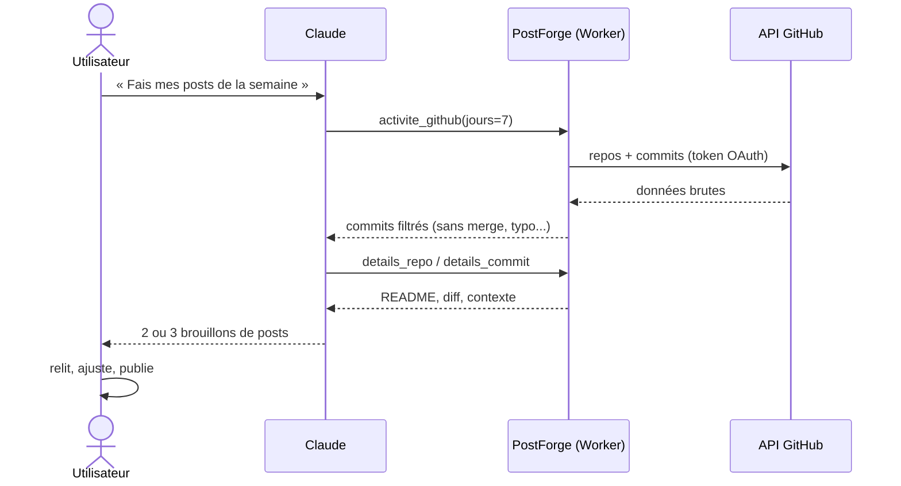
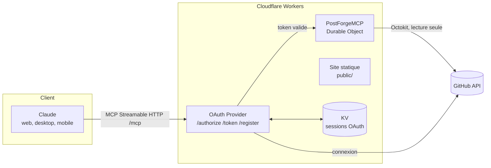

# PostForge

**Ton code de la semaine devient tes posts LinkedIn.**

PostForge est un **connecteur MCP** (Model Context Protocol) qui relie ton GitHub à ton compte Claude. Tu demandes *« fais mes posts LinkedIn de la semaine »*, Claude lit tes commits grâce aux outils de PostForge et rédige les posts, avec ton propre abonnement, sans clé API.

> Statut : **bêta en développement**. Voir la [feuille de route](docs/roadmap.md).

---

## Pourquoi

Les développeurs construisent beaucoup et montrent peu. Écrire un post prend du temps, et on oublie vite ce qu'on a fait il y a trois jours. PostForge transforme le travail déjà fait (les commits) en matière première pour des posts authentiques.

**Le choix d'architecture clé** : PostForge n'appelle aucune IA lui-même. C'est le Claude de l'utilisateur qui pilote les outils. Conséquences :

- aucune clé API à fournir, aucun coût d'IA côté serveur ;
- l'utilisateur garde le contrôle de la conversation et relit avant de publier ;
- le serveur reste léger, sans état sensible, et gratuit à héberger.

## Comment ça marche



## Architecture



Détails dans [docs/architecture.md](docs/architecture.md).

## Outils MCP

| Outil | Rôle |
|---|---|
| `activite_github` | Commits récents sur tes repos publics, sans le bruit |
| `details_repo` | Description, site, langages et README d'un projet |
| `details_commit` | Fichiers modifiés et extraits du diff d'un commit |
| `posts_semaine` *(prompt)* | Guide Claude pour rédiger 2 ou 3 posts |

Référence complète : [docs/outils.md](docs/outils.md).

## Sécurité

- Scope GitHub minimal : `read:user`, repos publics uniquement.
- OAuth 2.1 avec PKCE, protection CSRF et écran de consentement.
- Token GitHub chiffré dans le token MCP, jamais exposé au client.
- Aucune publication automatique.

Modèle de menace et choix détaillés : [docs/securite.md](docs/securite.md).

## Démarrer en local

Voir [docs/installation.md](docs/installation.md).

```bash
npm install
cp .dev.vars.example .dev.vars   # renseigner les secrets GitHub OAuth
npm run dev
```

## Structure du projet

```
postforge/
├── public/                 site vitrine (HTML, CSS, JS vanilla)
├── src/
│   ├── index.ts            serveur MCP + déclaration des outils
│   ├── prompts.ts          prompt posts_semaine
│   ├── outils/
│   │   ├── github.ts       appels à l'API GitHub
│   │   └── filtre.ts       filtrage du bruit dans les commits
│   ├── github-handler.ts   flux OAuth GitHub
│   ├── workers-oauth-utils.ts  CSRF, consentement, cookies
│   └── utils.ts
├── docs/                   documentation
└── wrangler.jsonc          configuration Cloudflare
```

## Stack

Cloudflare Workers, Durable Objects, KV · Agents SDK (`McpAgent`) · `@cloudflare/workers-oauth-provider` · Octokit · TypeScript côté serveur, HTML/CSS/JS vanilla côté site.

## Licence

MIT
