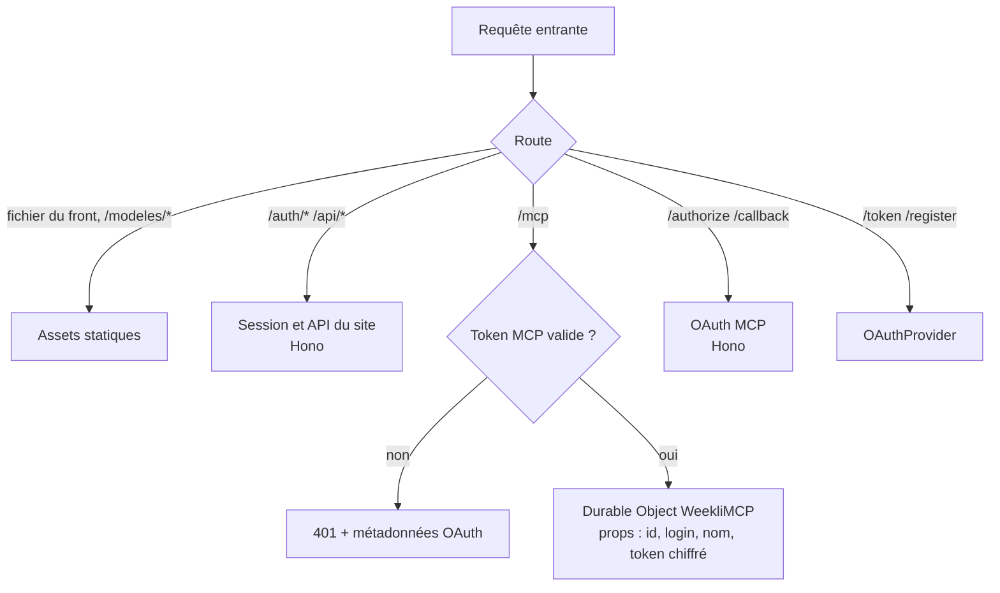
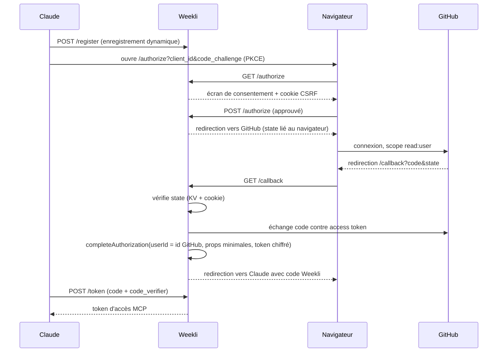
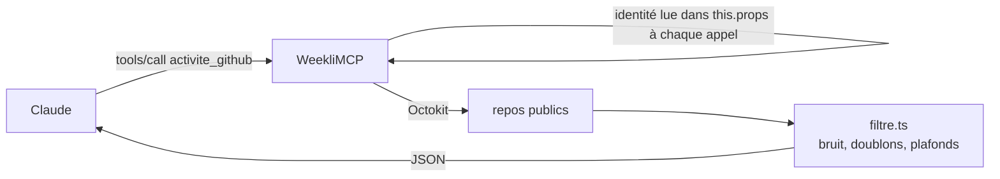
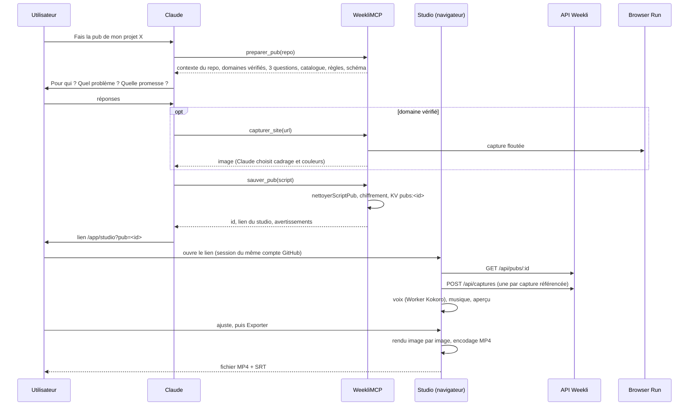
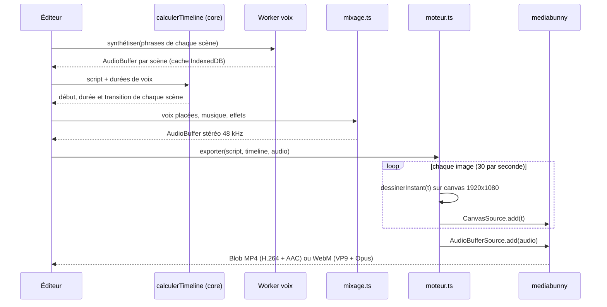
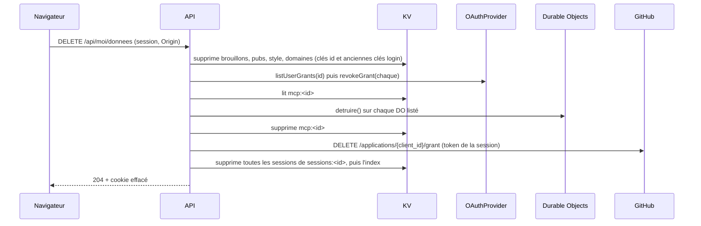

# Architecture

Mis à jour le 2026-10-24 pour la V1 (voir `docs/brief.md`). Les sections 1 à 4 décrivent l'existant, toujours vrai sauf mention ; les sections 5 à 9 décrivent ce que la V1 ajoute ; la section 10 regroupe les décisions (ADR).

## 1. Vue d'ensemble

Le dépôt est un **monorepo npm** :

| Paquet | Rôle |
|---|---|
| `packages/core` | Moteur partagé : lecture GitHub, filtrage, prompts, types, **validation des scripts de pub, timeline, palette, style** (V1) |
| `apps/server` | Worker Cloudflare, déployé seul |
| `apps/web` | Front React, compilé puis servi par le Worker |
| `apps/video` | Outil **interne** Remotion pour la pub de lancement de Weekli lui-même. Pas déployé, pas utilisé par les utilisateurs |

En production, Weekli est un seul **Cloudflare Worker** qui joue quatre rôles :

1. **Serveur d'autorisation OAuth** pour les clients MCP (Claude), via `@cloudflare/workers-oauth-provider`.
2. **Serveur MCP** sur `/mcp`, une instance de `WeekliMCP` (un Durable Object par session).
3. **API du site** sur `/api/*`, avec sa propre connexion GitHub sur `/auth/*`.
4. **Hébergement du front** React compilé, en application monopage, y compris les **fichiers du modèle vocal** (V1, ADR-08).

Principe inchangé : **le serveur n'appelle jamais d'IA**. En mode MCP, Claude pilote avec l'abonnement de l'utilisateur ; en mode site, le navigateur appelle Anthropic avec la clé de l'utilisateur ; la voix off et le rendu vidéo tournent dans le navigateur.



## 2. Le double OAuth

Weekli est à la fois **serveur** OAuth (face à Claude) et **client** OAuth (face à GitHub). Claude ne voit jamais le token GitHub : il reçoit un token Weekli, qui contient le token GitHub dans ses `props`. En V1, ce token est en plus chiffré avec `chiffrer()` avant d'entrer dans les props (ADR-03), car la bibliothèque `agents` recopie les props dans le stockage du Durable Object.



## 3. Cycle d'un appel d'outil



Le filtrage limite la réponse à **10 repos et 30 commits par repo**. En V1, chaque outil relit l'identité dans `this.props` au moment de l'appel (et plus une variable figée dans `init()`, audit m6).

## 4. Pourquoi ces choix (existant)

| Choix | Raison |
|---|---|
| Connecteur MCP plutôt qu'app avec clé API | L'utilisateur utilise son abonnement Claude de façon officielle, aucun coût d'IA pour le serveur |
| Cloudflare Workers | Gratuit à petite échelle, déployé partout, OAuth et Durable Objects intégrés |
| Durable Object par session | État isolé par utilisateur, imposé par `McpAgent` |
| Pas d'appel LLM côté serveur | Surface d'attaque et coûts réduits, l'IA reste chez l'utilisateur |
| Monorepo avec `@weekli/core` | Une seule implémentation de la lecture GitHub, des prompts et des validations pour les deux modes |
| Génération dans le navigateur (mode clé API) | La clé API ne touche jamais le serveur |
| React + CSS Modules | Existant conservé (changelog du 2026-10-24), styles sans collision, chargement différé |

## 5. Ce que la V1 ajoute

```mermaid
flowchart LR
    subgraph Claude
        CL[Claude web, desktop, mobile]
    end
    subgraph Navigateur
        ST[Studio de pub<br/>React]
        MO[Moteur de rendu<br/>canvas 2D + WebCodecs]
        VX[Worker voix<br/>Kokoro ONNX]
        AU[Audio<br/>musique, mixage]
        IDB[(IndexedDB<br/>voix, logo, images)]
        ST --> MO
        ST --> VX
        VX --> IDB
        MO --> AU
    end
    subgraph Worker[Worker Cloudflare]
        MCP[Outils MCP<br/>+ preparer_pub, sauver_pub,<br/>lire_style, sauver_style...]
        API[API JSON<br/>+ /api/pubs, /api/style,<br/>/api/repos, /api/moi/donnees]
        CORE[[@weekli/core<br/>+ pub/, style.ts]]
        KV[(KV chiffré<br/>par id GitHub)]
        BR[Browser Run<br/>captures]
        AS[Assets<br/>/modeles/kokoro/*]
        MCP --> CORE
        API --> CORE
        MCP --> KV
        API --> KV
        API --> BR
    end
    CL -- MCP --> MCP
    ST -- session --> API
    VX -- fichiers du modèle --> AS
    CORE -- lecture seule --> GH[(GitHub)]
```

### 5.1 Arborescence cible

Les fichiers marqués `(V1)` sont à créer, `(modifié)` à faire évoluer, `(retiré)` à supprimer.

```
weekli/
├── apps/
│   ├── server/src/
│   │   ├── index.ts                    OAuthProvider, refreshTokenTTL explicite (modifié)
│   │   ├── types.ts                    Props { id, login, nom, jeton } ; Session { id, login, nom, avatar, token } (modifié)
│   │   ├── mcp/
│   │   │   ├── agent.ts                Enregistrement des outils, identité relue par appel, alarme d'inactivité (modifié)
│   │   │   ├── outils-github.ts        activite_github, details_repo, details_commit, lister_repos (V1, extrait d'agent.ts)
│   │   │   ├── outils-brouillons.ts    sauver_brouillons, lister_brouillons (V1, extrait)
│   │   │   ├── outils-pub.ts           preparer_pub, sauver_pub, lister_pubs, lire_pub, prompt pub_projet (V1)
│   │   │   └── outils-style.ts         lire_style, sauver_style (V1)
│   │   ├── routes/
│   │   │   ├── api.ts                  Routeur et middleware (modifié)
│   │   │   ├── api-pubs.ts             /api/pubs (V1)
│   │   │   ├── api-style.ts            /api/style (V1)
│   │   │   ├── api-moi.ts              /api/moi, GET et DELETE /api/moi/donnees (V1, extrait)
│   │   │   ├── auth.ts                 Session avec id, index des sessions, révocation du token à la déconnexion (modifié)
│   │   │   ├── oauth-mcp.ts            userId = id GitHub, props minimales (modifié)
│   │   │   └── app.ts
│   │   └── lib/
│   │       ├── chiffrement.ts          Base64 par blocs, sans limite de taille (modifié, audit m9)
│   │       ├── conservation.ts         CONSERVATION_SECONDES, filtrerPerimes() (modifié)
│   │       ├── identite.ts             cleUtilisateur(prefixe, id), migration depuis le login (V1)
│   │       ├── sessions.ts             Index sessions:<id>, suppression de toutes les sessions (V1)
│   │       ├── revocation.ts           Révocation GitHub (token, grant), grants MCP, Durable Objects (V1)
│   │       ├── donnees.ts              effacerDonnees(), exporterDonnees() (modifié)
│   │       ├── brouillons.ts           Clé par id (modifié)
│   │       ├── domaines.ts             Clé et HMAC par id (modifié)
│   │       ├── pubs.ts                 Scripts de pub chiffrés (V1)
│   │       ├── style.ts                Style chiffré (V1)
│   │       └── capture.ts, flou.ts, url-capture.ts, validation.ts, pages.ts, securite.ts, session.ts, github-oauth.ts
│   ├── web/
│   │   ├── public/
│   │   │   ├── fonts/                  Geist, Instrument Serif, JetBrains Mono en woff2 (V1, audit M4)
│   │   │   └── modeles/                Modèle vocal découpé, généré par script, non versionné (V1)
│   │   └── src/
│   │       ├── lib/
│   │       │   ├── api.ts              + pubs, style, repos, export (modifié)
│   │       │   ├── generation.ts       + genererScriptPub (modifié), - genererStoryboard
│   │       │   ├── reglages.ts         Style retiré du navigateur, migration (modifié)
│   │       │   ├── video/              (retiré : moteur.ts, scenes.ts)
│   │       │   └── pub/                (V1)
│   │       │       ├── moteur.ts       Timeline, lecture (horloge audio), export WebCodecs
│   │       │       ├── contexte.ts     Palette, polices, images, logo prêts pour le dessin
│   │       │       ├── rendu/
│   │       │       │   ├── fonds.ts        Fond sombre de marque, fond clair, motif de carrés, grain
│   │       │       │   ├── texte.ts        Typographie cinétique : mots, surlignage, frappe, filigrane
│   │       │       │   ├── cartes.ts       Carte navigateur, carte mobile, carte liste, tampon
│   │       │       │   ├── marque.ts       Logo, monogramme pixel
│   │       │       │   ├── transitions.ts  coupe, glitch, flou, pixels
│   │       │       │   ├── effets.ts       Rayons, particules, onde
│   │       │       │   └── scenes/         Un fichier par type de scène (11 fichiers)
│   │       │       ├── audio/
│   │       │       │   ├── voix/           Voix off (F1) : client.ts, worker.ts, kokoro.ts, phonemes.ts (espeak-ng), prononciation.ts, cache.ts (IndexedDB)
│   │       │       │   ├── musique.ts      Synthèse (port de apps/video/scripts/audio.mjs)
│   │       │       │   └── mixage.ts       OfflineAudioContext, ducking, effets
│   │       │       ├── captures.ts     Chargement, recadrage, ImageBitmap
│   │       │       ├── couleurs.ts     Extraction des couleurs dominantes d'une capture
│   │       │       ├── stockage.ts     IndexedDB : voix, logo, images importées
│   │       │       └── sous-titres.ts  Export SRT
│   │       └── pages/
│   │           ├── Studio/             Refonte complète (V1), voir docs/design.md section 9
│   │           ├── Reglages/           + PanneauStyle (V1), PanneauDonnees : export (modifié)
│   │           └── Legal/              Confidentialité alignée sur docs/specs.md section 5 (modifié)
│   └── video/                          Outil interne, format « histoire » retiré (modifié)
├── packages/core/src/
│   ├── pub/                            (V1)
│   │   ├── types.ts                    ScriptPub, ScenePub, Marque, Capture
│   │   ├── limites.ts                  LIMITES_PUB, durées par type
│   │   ├── nettoyer.ts                 nettoyerScriptPub() : { script, avertissements }
│   │   ├── schema.ts                   SCHEMA_SCRIPT_PUB (JSON Schema)
│   │   ├── timeline.ts                 calculerTimeline(script, dureesVoix)
│   │   ├── palette.ts                  paletteDepuisMarque(), contraste()
│   │   ├── guide.ts                    Règles de rédaction et catalogue, partagés MCP et site
│   │   └── modele.ts                   scriptPubDepuisReponses() (sans IA)
│   ├── style.ts                        StyleEcriture, nettoyerStyle() (V1)
│   ├── github.ts                       + listerRepos() (modifié)
│   ├── prompts.ts                      promptPostsSemaine(jours, style) inchangé, style injecté par le serveur
│   └── storyboard.ts                   (retiré)
├── scripts/
│   └── modeles-voix.mjs                Télécharge, vérifie (SHA-256) et découpe le modèle vocal (V1)
└── docs/
```

### 5.2 Modèle de données

Tout est dans le namespace KV `OAUTH_KV`, chiffré en AES-256-GCM avec une clé dérivée par usage (`chiffrer(cle, usage, valeur)`), et indexé par l'**id GitHub numérique** (ADR-01).

```mermaid
erDiagram
    UTILISATEUR ||--o{ SESSION : "sessions:<id> liste"
    UTILISATEUR ||--o| BROUILLONS : "brouillons:<id>"
    UTILISATEUR ||--o| PUBS : "pubs:<id>"
    UTILISATEUR ||--o| STYLE : "style:<id>"
    UTILISATEUR ||--o| DOMAINES : "domaines:<id>"
    UTILISATEUR ||--o{ GRANT_MCP : "géré par OAuthProvider (userId)"
    UTILISATEUR ||--o{ DO_MCP : "mcp:<id> liste des noms de DO"

    UTILISATEUR {
        string id "id GitHub numérique, immuable"
        string login "affichage seulement"
    }
    SESSION {
        string cle "session:<64 hex>"
        string id
        string login
        string nom
        string avatar
        string token "token GitHub"
        int ttl "8 h"
    }
    BROUILLONS {
        json liste "Brouillon[] (100 max)"
        int ttl "90 jours, renouvelé à l'écriture"
    }
    PUBS {
        json liste "PubEnregistree[] (20 max)"
        int ttl "90 jours, renouvelé à l'écriture"
    }
    STYLE {
        string exemples "8000 car. max"
        string profil "2000 car. max"
        string maj "ISO 8601"
        int ttl "90 jours"
    }
    DOMAINES {
        json liste "Domaine[] (10 max)"
        int ttl "90 jours"
    }
    GRANT_MCP {
        string userId "id GitHub"
        json props "id, login, nom, jeton chiffré"
        int refresh "30 jours non renouvelés"
    }
    DO_MCP {
        string nom "id de session MCP"
        json props "copie des props (jeton chiffré)"
        int alarme "destruction après 24 h d'inactivité"
    }
```

Côté navigateur (jamais envoyé au serveur) : IndexedDB `weekli` avec les magasins `voix` (audio généré, clé = empreinte SHA-256 du texte et des réglages), `fichiers` (logo et images importées, clé = id de pub et rôle), et le cache HTTP du modèle vocal.

## 6. Flux principaux V1

### 6.1 Pub écrite dans Claude, rendue sur le site



### 6.2 Rendu et export dans le navigateur



### 6.3 Effacement complet



## 7. Pub vidéo : principes du moteur

Le détail visuel est dans `docs/design.md` (sections 8 et 9). Les règles techniques :

1. **Fonction pure du temps** : `dessinerInstant(ctx, scene, tLocal, contexte)` ne dépend que du temps et des données. Aucun état d'animation, aucun `Math.random()` (générateur pseudo-aléatoire initialisé par l'id de la scène). L'aperçu et l'export donnent donc exactement la même image.
2. **La voix fixe le tempo** : la durée d'une scène vaut `max(dureeMin(type), voix + 0,35 s)`, bornée à `dureeMax(type)`. Sans voix, `duree` du script ou la durée par défaut du type. La timeline est calculée dans `@weekli/core` (testable).
3. **Chevauchement des transitions** : chaque transition dure entre 0,25 et 0,6 s et se superpose à la fin de la scène précédente ; la timeline en tient compte.
4. **Résolution** : rendu natif 1920 × 1080 pour l'export ; aperçu dessiné à 960 × 540 (`ctx.scale(0.5, 0.5)`) pour rester fluide.
5. **Horloge maître = audio** pendant l'aperçu (`AudioContext.currentTime`), pour une synchronisation exacte voix et image.
6. **Export image par image** (pas en temps réel), avec `await` régulier pour garder l'interface réactive, annulable.
7. **Captures** chargées une fois en `ImageBitmap`, recadrées à la demande. Jamais stockées côté serveur.
8. **Polices** chargées explicitement (`document.fonts.load`) avant tout dessin, hébergées localement.

## 8. Style d'écriture

- Stockage : `style:<id>` dans KV, chiffré, usage `style`, TTL de 90 jours (ADR-04).
- MCP : `lire_style`, `sauver_style`. Le prompt `posts_semaine` injecte le style stocké si l'argument `style` est absent.
- Site : `GET`, `PUT`, `DELETE /api/style`. La génération en mode clé API passe le style à `systemeGeneration` comme aujourd'hui, mais le lit depuis l'API.
- Migration : au premier affichage des Réglages, si `localStorage` contient un style et que le serveur n'en a pas, le front fait `PUT /api/style` puis retire la valeur locale.

## 9. Sécurité des nouveaux modules

| Sujet | Mesure |
|---|---|
| Script de pub venu de Claude ou du navigateur | `nettoyerScriptPub` : types connus uniquement, textes tronqués, couleurs `#rrggbb`, URLs de capture `https` sur domaine vérifié (revérifié au moment de la capture), durées bornées. Le script ne contient que des données, jamais de code |
| Contenus de repo envoyés à Claude par `preparer_pub` | Placés dans un champ `contenu_non_fiable`, rappel dans la description de l'outil (audit m7) |
| Taille | Corps des requêtes limité à 64 Ko ; script sérialisé limité à 24 Ko ; 20 pubs par compte |
| Images importées et logo | Lus localement en `ImageBitmap` (pas de rendu SVG dans le DOM), 512 Ko pour le logo, 5 Mo par image, jamais envoyés |
| Modèle vocal | Servi depuis le même domaine, empreinte SHA-256 vérifiée par le Worker vocal avant usage ; aucune nouvelle origine dans la CSP |
| Worker vocal | `worker-src 'self'`, onnxruntime-web en WASM local ; `script-src 'self' 'wasm-unsafe-eval'` : autorise la seule compilation de WebAssembly, ni `eval` ni `new Function` ni script inline (en place dans `_headers` ; à revérifier à la main dans un Chrome non piloté pendant l'audit) |
| Isolation cross-origin | `Cross-Origin-Opener-Policy: same-origin` et `Cross-Origin-Embedder-Policy: require-corp` dans `_headers` : la page est `crossOriginIsolated`, condition du calcul de la voix sur 4 fils (ADR-07). Toute ressource tierce doit alors être chargée avec `crossorigin="anonymous"` (avatars GitHub, qui répondent `Access-Control-Allow-Origin: *`) |
| Contenus de repo (`details_commit`) | Extraits de diff masqués par `masquerSecrets` pour les formats de jetons connus seulement, sans motif générique (voir `api-contract.md` 4.1) |

## 10. Décisions (ADR)

### ADR-01 : identité par id GitHub numérique, migration des clés

- **Contexte** : clés KV, jeton HMAC des domaines, limitation de débit et outils MCP reposent sur le login GitHub, renommable et réattribuable (audit M3). Un nouveau titulaire du login hériterait des brouillons et des domaines.
- **Options** : (a) garder le login ; (b) id numérique sans migration ; (c) id numérique avec migration au premier login.
- **Décision** : (c). `Session` et `Props` portent `id` (chaîne de l'id numérique). Toutes les clés deviennent `<prefixe>:<id>`, le HMAC des domaines est calculé sur l'id, les clés de débit aussi (`api:<id>`, `mcp:<id>`, `capture:<id>`). Migration dans `lib/identite.ts` : à chaque connexion (site ou MCP), pour chaque préfixe, si `<prefixe>:<login>` existe et `<prefixe>:<id>` non, recopier puis supprimer l'ancienne clé. Les domaines migrés gardent leur date mais seront revérifiés avec le nouveau jeton (audit m5).
- **Conséquences** : Weekli n'a jamais été déployé publiquement : les seules clés à migrer sont locales, donc la migration ne peut pas profiter à un squatteur. Elle sera **retirée avant le déploiement public** (tâche dédiée), pour ne jamais rattacher des données à un login en production. `effacerDonnees` supprime aussi les anciennes clés par login tant que la migration existe.

### ADR-02 : effacement réellement complet

- **Contexte** : l'effacement actuel laisse les grants MCP, les Durable Objects, les autres sessions et l'autorisation GitHub (audit M1, M2, m2).
- **Décision** : `DELETE /api/moi/donnees` exécute, dans cet ordre, en continuant même si une étape échoue (chaque échec est journalisé sans donnée personnelle, et la réponse reste `204` si les données KV sont supprimées) :
  1. Suppression KV : `brouillons:`, `pubs:`, `style:`, `domaines:` pour l'id (et le login tant que la migration ADR-01 existe).
  2. Grants MCP : `OAUTH_PROVIDER.listUserGrants(id)` puis `revokeGrant(grantId, id)` pour chacun (tokens d'accès et de rafraîchissement compris).
  3. Durable Objects : lecture de l'index `mcp:<id>` (noms des DO de l'utilisateur, alimenté par `WeekliMCP` à l'initialisation), appel de la méthode RPC `detruire()` qui fait `this.destroy()`, puis suppression de l'index.
  4. GitHub : `DELETE https://api.github.com/applications/{client_id}/grant` (authentification basique client_id et secret, corps `{ access_token }`) avec le token de la session : révoque l'autorisation de l'app pour ce compte, donc tous ses tokens. Si GitHub refuse, étape journalisée et ignorée.
  5. Sessions : suppression de toutes les clés listées dans `sessions:<id>`, puis de l'index, puis effacement du cookie.
- **Index des sessions** : `creerSession` ajoute l'id de session à `sessions:<id>` (TTL 8 h, liste plafonnée à 20, entrées expirées nettoyées à l'écriture).
- **Déconnexion** (`POST /auth/logout`) : révoque en plus le token de la session (`DELETE /applications/{client_id}/token`), sans toucher au grant, pour ne pas couper le connecteur Claude.
- **Conséquences** : après effacement, Claude doit refaire l'autorisation. L'utilisateur est prévenu dans le panneau de confirmation.

### ADR-03 : props MCP minimales et chiffrées, Durable Objects à durée bornée

- **Contexte** : props en clair dans le stockage DO, sans durée (M2) ; email collecté sans usage (m1) ; login figé à l'initialisation (m6).
- **Décision** :
  - `Props = { id, login, nom, jeton }` où `jeton` est le token GitHub chiffré par `chiffrer(cle, "props-mcp", token)`. Plus d'`email`. Le getter `octokit` déchiffre à la volée.
  - `refreshTokenTTL` fixé explicitement à 30 jours dans `OAuthProvider`.
  - Chaque outil lit `this.props.id` au moment de l'appel. À la première initialisation, le DO enregistre l'id propriétaire ; si un appel arrive avec d'autres props, il est refusé (`isError`).
  - À chaque appel d'outil, le DO reprogramme une alarme à 24 h ; à son déclenchement, `this.destroy()` efface tout son stockage. À l'initialisation, il ajoute son nom à `mcp:<id>` (ADR-02).
- **Conséquences** : une session Claude inactive plus de 24 h recrée un DO au prochain appel, sans impact visible (le token MCP reste valable).

### ADR-04 : style d'écriture stocké côté serveur

- **Contexte** : brief section 6 et page Confidentialité ; aujourd'hui en `localStorage`.
- **Options** : (a) navigateur seulement ; (b) KV chiffré ; (c) dans le Durable Object.
- **Décision** : (b) `style:<id>`, même schéma que les brouillons (chiffré, TTL 90 jours). Contenu : `exemples` (posts bruts de l'utilisateur) et `profil` (synthèse écrite par Claude). Le DO est exclu : un DO par session MCP, le site n'y a pas accès.
- **Conséquences** : un seul style partagé entre Claude et le site ; migration automatique depuis le navigateur (section 8).

### ADR-05 : scripts de pub, validation partagée et stockage

- **Contexte** : le script vient de Claude (MCP), de Claude (clé API) ou de l'éditeur ; il doit être validé partout pareil.
- **Options de stockage** : (a) étendre `Brouillon` avec un type ; (b) collection séparée `pubs:<id>` ; (c) une clé KV par pub.
- **Décision** : (b). Une collection séparée garde le type `Brouillon` simple et permet ses propres limites (20 pubs, 24 Ko chacune, environ 500 Ko au pire). Prérequis : base64 par blocs dans `chiffrement.ts` (audit m9). La validation `nettoyerScriptPub` et le schéma vivent dans `@weekli/core`, utilisés par l'outil MCP, l'API et l'éditeur.
- **Conséquences** : le studio liste les pubs ; la page Historique reste dédiée aux posts.

### ADR-06 : moteur de rendu de la pub dans le navigateur

- **Contexte** : il faut une pub 1920 × 1080 de 60 s au niveau Stepwize, rendue chez l'utilisateur, à 0 €.
- **Options** :

| Option | Pour | Contre |
|---|---|---|
| (a) Étendre le moteur existant : canvas 2D + WebCodecs (mediabunny) | Déjà en production, export MP4 éprouvé, déterministe, léger, aucune dépendance nouvelle | Effets lourds (flou, glitch) à écrire à la main ; pas de piste audio aujourd'hui |
| (b) WebGL (Three.js ou shaders maison) pour tout le rendu | Effets riches et rapides | Texte et mise en page pénibles en WebGL, double coût de développement, poids |
| (c) Remotion dans le navigateur | Composants React, même outil que `apps/video` | Rendu navigateur expérimental, licence entreprise, très lourd pour l'utilisateur |
| (d) Rendu serveur (Browser Run, ffmpeg) | Rendu identique partout | Payant ou quota très bas, contraire au principe « rien de lourd côté serveur » |
| (e) Animations CSS du DOM puis capture | Facile à écrire | Capture image par image du DOM non fiable et lente |

- **Décision** : (a). Le moteur est réécrit dans `lib/pub/` en gardant ses deux idées (fonction pure du temps, encodage WebCodecs image par image) et ajoute : timeline en scènes avec transitions superposées, couches (fond, scène, transition), piste audio via `AudioBufferSource` de mediabunny, aperçu à demi-résolution. Les effets signature (rayons, pixels, glitch par tranches et décalage RVB, flou via `ctx.filter`) sont tous faisables en canvas 2D. Un repli sans `ctx.filter` (flou désactivé) est prévu pour les navigateurs qui ne le gèrent pas.
- **Conséquences** : export validé sur Chrome et Edge desktop (cible du brief) ; Firefox et Safari : WebM ou message explicite. Le rendu d'une image complexe à 1920 × 1080 doit tenir sous 60 ms pour un export de 60 s en moins de 2 minutes (mesure dans la tâche moteur).

### ADR-07 : voix off française gratuite

- **Contexte** : voix off féminine française, 0 €, rendue pour n'importe quel utilisateur. Banc d'essai réalisé le 2026-10-24 sur le même texte de 53 mots, ton pub (fichiers dans `.bench-voix/ecoute/`, mode d'emploi dans `.bench-voix/LISEZMOI.md`). Les jugements de qualité ci-dessous sont des attentes, **le choix final revient à Soufiane à l'oreille**.

| | edge-tts (Microsoft Edge) | Kokoro 82M, voix `ff_siwis` | Piper, voix `fr_FR-siwis` et `upmc` (jessica) | macOS `say` (actuel, interne) |
|---|---|---|---|---|
| Voix testées | Denise, Eloise, Vivienne (multilingue), avec et sans accélération | ff_siwis en fp32, int8, vitesse 1,1, prononciation corrigée | siwis medium, upmc medium jessica, prononciation corrigée | Thomas (masculine) |
| Qualité attendue | La meilleure : voix neuronales Azure, prosodie naturelle, Vivienne la plus expressive | Bonne pour un modèle de 82 M de paramètres, une seule voix française, notée en dessous des voix anglaises par son auteur | Correcte mais plus synthétique, 22 kHz | Synthétique |
| Durée du texte | Denise 25,3 s (lente, +12 % conseillé), Vivienne 18,9 s | 16,9 s (rapide, débit pub naturel) | 18,6 s | 19,1 s |
| Licence du code | `edge-tts` : LGPL-3.0 | Poids Apache-2.0, `kokoro-onnx` MIT, onnxruntime MIT | `piper-tts` 1.8 (piper1-gpl) : GPL-3.0 | Système |
| Licence des voix | Service Microsoft, aucune licence d'usage tiers publiée | ff_siwis entraînée sur SIWIS (CC-BY 4.0, attribution) | siwis CC-BY 4.0, upmc CC-BY-SA 4.0 ; les deux affinées depuis la voix anglaise lessac, dont le corpus d'origine a une licence restrictive (à vérifier) | Apple, usage local |
| Phonémiseur | Aucun (côté Microsoft) | espeak-ng (GPL-3.0) | espeak-ng (GPL-3.0) | Système |
| Conditions d'usage | **Usage non officiel** du service « Lecture à voix haute » d'Edge : point d'accès non documenté, jeton `Sec-MS-GEC` rétro-conçu, aucune autorisation de Microsoft pour un usage par un service tiers. Le texte part chez Microsoft | Libre | Libre | Mac uniquement, non distribuable aux utilisateurs |
| Où ça tourne | Serveur ou poste local uniquement (le navigateur ne peut pas forger les en-têtes exigés) : il faudrait que le Worker Weekli appelle Microsoft pour chaque utilisateur | **Navigateur**, dans un Web Worker (onnxruntime-web, WASM ou WebGPU) ; local en Python pour le banc | Navigateur (portages WASM communautaires) ou local | Mac local |
| Coût | 0 € | 0 €, téléchargement unique d'environ 90 Mo (modèle int8) par utilisateur, mis en cache | 0 €, 63 à 77 Mo | 0 € |
| Vitesse mesurée (CPU Apple Silicon natif) | Réseau | int8 : 10,3 s de calcul pour 16,7 s d'audio ; fp32 : 17,5 s pour 16,9 s. Dans le navigateur en WASM, prévoir 2 à 4 fois plus (à mesurer) | 3,4 s pour 18,6 s | Instantané |
| Risques | Coupure ou blocage à tout moment (déjà arrivé en 2024), atteinte à l'image d'un projet portfolio, texte de l'utilisateur envoyé à un tiers sans contrat (RGPD), dépendance serveur contraire au principe « pas d'appel tiers côté serveur » | Mots anglais mal prononcés (espeak-ng lit « GitHub » « ji eub ») : dictionnaire de prononciation obligatoire ; téléchargement lourd ; lent sur machine modeste ; portage navigateur du français à construire (kokoro-js ne gère que l'anglais) ; GPL d'espeak-ng | Qualité perçue « robot » sur une pub ; chaîne de licences floue ; GPL | Non utilisable dans le produit |

- **Options écartées d'emblée** : API Web Speech (`speechSynthesis`), voix différentes selon le système et impossibles à enregistrer proprement ; services payants (ElevenLabs, Azure avec clé), contraires au budget.
- **Décision recommandée** : **Kokoro `ff_siwis`, exécuté dans le navigateur** (Web Worker), modèle int8 servi par Weekli (ADR-08), avec dictionnaire de prononciation dans le script et possibilité d'**importer sa propre voix off**. Raisons : seule option à la fois gratuite, légale sans ambiguïté sur le modèle, sans serveur et sans envoi du texte à un tiers, avec une qualité acceptable pour une pub. edge-tts n'est pas retenu pour le produit malgré sa qualité ; il reste envisageable pour la pub de lancement de Weekli faite en local avec `apps/video`, sous la responsabilité de Soufiane.
- **Conséquences** :
  - Le phonémiseur espeak-ng (GPL-3.0) est distribué avec le front : **le dépôt entier est passé en GPL-3.0-only** (`LICENSE`, `README.md`, `package.json`, commit `053901d`), ce qui résout la décision H2. `GPL-3.0-or-later` reste possible (espeak-ng est en `-or-later`), au choix de Soufiane. Piper aurait eu la même contrainte.
  - **Mise en œuvre retenue (F1, 2026-10-25)** : Kokoro `ff_siwis` en **int8** (`model_quantized.onnx`, 92 Mo) et la seule voix `voices/ff_siwis.bin` (0,5 Mo, au lieu des 28 Mo de toutes les voix), dans un Web Worker, onnxruntime-web en WASM, pipeline de phonèmes de kokoro-onnx 0.6.1, espeak-ng réduit au français et à l'anglais (967 Ko). Corrélation spectrale 0,999 avec l'écoute de référence 09. Le WebGPU est écarté pour la V1 (plus lent en int8, et un binaire WASM de 26,8 Mo dépasse la limite de 25 Mio des assets).
  - **Isolation cross-origin nécessaire** : sur un seul fil la synthèse du texte du banc (53 mots, 16 s d'audio) prend 106 s ; sur 4 fils, 40 à 61 s (quatre mesures : 39,9 / 45,4 / 53,7 / 61,3 s, machine M1 très chargée, donc pessimistes) ; 8 fils font pire (85 s, cœurs d'efficacité). Le multithread WASM exige une page `crossOriginIsolated`, donc `COOP: same-origin` et `COEP: require-corp` (voir section 9). Chargement : 2,5 s en local, auquel s'ajoute le téléchargement réel de 94 Mo, une seule fois grâce au cache.
  - **Mesures à compléter** : Edge, Firefox et Safari n'ont pas été mesurés (seul Chrome était pilotable). Safari gère `require-corp` mais pas `credentialless`. Une écoute finale par Soufiane et des mesures au calme restent à faire.
  - Si l'isolation est refusée, la voix marche mais en 1 min 45 s environ pour 16 s d'audio. Repli prévu en cas d'échec de F1 (Piper, puis voix importée seule) : non nécessaire.
  - Mention d'attribution SIWIS (CC-BY 4.0) dans les mentions légales (tâche F12).

### ADR-08 : hébergement du modèle vocal

- **Contexte** : environ 90 Mo (modèle int8) + la voix `ff_siwis` seule (0,5 Mo) + les données espeak-ng (967 Ko) ; 94 Mo de fichiers vocaux au total, plus 14,2 Mo de WASM onnxruntime et 0,86 Mo de Worker. Les assets Workers sont limités à 25 Mo par fichier ; charger depuis Hugging Face enverrait l'IP de l'utilisateur à un tiers (même problème que les polices, audit M4) et ajouterait des origines à la CSP.
- **Options** : (a) Hugging Face à l'exécution ; (b) bucket R2 ; (c) assets du Worker découpés en morceaux de moins de 25 Mo.
- **Décision** : (c). `scripts/modeles-voix.mjs` télécharge une révision **épinglée** du modèle (dépôt `onnx-community/Kokoro-82M-v1.0-ONNX`, révision `1939ad2a8e416c0acfeecc08a694d14ef25f2231`, fichiers `onnx/model_quantized.onnx` et `voices/ff_siwis.bin`, empreintes SHA-256 épinglées dans `apps/web/src/lib/voix/outils/preparer-modeles.mjs`), vérifie les SHA-256 notés dans le script, découpe en morceaux de 20 Mo dans `apps/web/public/modeles/kokoro/` (non versionné) avec un `manifeste.json` (morceaux, tailles, empreinte globale). Le Worker vocal télécharge les morceaux, recolle, vérifie l'empreinte, met en cache dans **IndexedDB** (une entrée par fichier vérifié, remplacée quand l'empreinte change ; pas Cache Storage). Le cache pèse environ 94 Mo par navigateur ; en navigation privée il échoue sans bloquer (la voix fonctionne mais retélécharge).
- **Conséquences** : même origine, `connect-src` inchangé, aucun tiers. La CSP gagne seulement `'wasm-unsafe-eval'` (script-src) et `worker-src 'self'`, et `_headers` ajoute `COEP: require-corp` (section 9). Le dépôt ne contient pas le modèle ; `npm run build` appelle le script (il ne retélécharge pas si les empreintes correspondent). Plan B si la limite de fichiers ou de taille du déploiement pose problème : R2 (offre gratuite) derrière une route du Worker.

### ADR-09 : musique et effets générés par le code

- **Décision** : porter `apps/video/scripts/audio.mjs` (synthèse additive sans dépendance) en TypeScript navigateur (`lib/pub/audio/musique.ts`), produire un `AudioBuffer` à la durée exacte, ambiances `energique` et `calme`. Effets : souffle sur chaque transition, montée puis impact sur la révélation, clic discret à chaque mot clé surligné. Mixage `OfflineAudioContext` avec baisse de la musique de 9 dB sous la voix (attaque 80 ms, relâchement 300 ms), normalisation à -16 LUFS approchée par crête et RMS.
- **Conséquences** : 100 % libre de droits, aucun fichier audio à héberger.

### ADR-10 : retrait des anciennes vidéos

- **Décision** : `packages/core/src/storyboard.ts`, `apps/web/src/lib/video/` et l'ancien Studio (vidéo verticale tirée d'un post, avec scènes terminal) sont retirés une fois le nouveau studio livré. Le format `histoire` est retiré de `apps/video` et du skill `video-projet` ; le format `presentation` du skill passe en 16:9 et suit la grammaire de `design.md`.
- **Raison** : le brief demande une refonte complète et interdit code, terminal et chiffres de développement dans la pub.

### ADR-11 : polices hébergées localement

- **Décision** : Geist (400, 500, 600, 700, 800), Instrument Serif (normal, italique) et JetBrains Mono (400, 500) en `woff2` dans `apps/web/public/fonts/`, `@font-face` dans `styles/fonts.css`, `font-display: swap`. Liens Google retirés, CSP `style-src 'self'; font-src 'self'` (audit M4). Le moteur de pub utilise les mêmes fichiers.

### ADR-12 : export des données

- **Décision** : `GET /api/moi/donnees` assemble profil, brouillons, pubs, style et domaines en un JSON téléchargeable (audit M5, droit d'accès et de portabilité). Pas de données binaires (les voix, logos et images ne sont pas sur le serveur).
