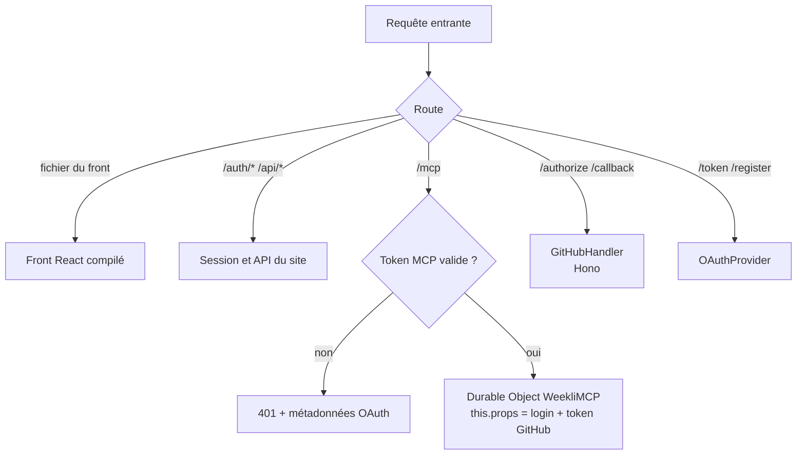
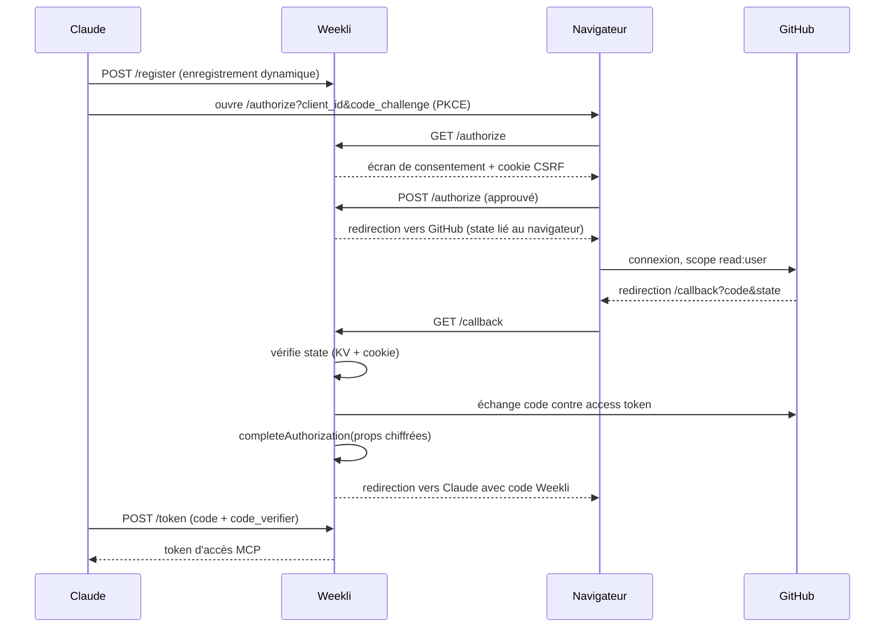
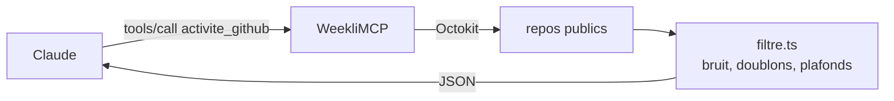

# Architecture

## Vue d'ensemble

Le dépôt est un **monorepo npm** en trois paquets :

| Paquet | Rôle |
|---|---|
| `packages/core` | Moteur partagé : lecture GitHub, filtrage, prompts, types |
| `apps/server` | Worker Cloudflare, déployé seul |
| `apps/web` | Front React, compilé puis servi par le Worker |

En production, Weekli est un seul **Cloudflare Worker** qui joue quatre rôles :

1. **Serveur d'autorisation OAuth** pour les clients MCP (Claude), via `@cloudflare/workers-oauth-provider`.
2. **Serveur MCP** sur `/mcp`, une instance de `WeekliMCP` (un Durable Object par session).
3. **API du site** sur `/api/*`, avec sa propre connexion GitHub sur `/auth/*`.
4. **Hébergement du front** React compilé, en application monopage.

## Le double OAuth

Weekli est à la fois **serveur** OAuth (face à Claude) et **client** OAuth (face à GitHub). Claude ne voit jamais le token GitHub : il reçoit un token Weekli, qui contient le token GitHub chiffré dans ses `props`.

## Cycle d'un appel d'outil

Le filtrage limite la réponse à **10 repos et 30 commits par repo**, pour garder le contexte de Claude lisible et éviter les réponses énormes.

## Pourquoi ces choix

| Choix | Raison |
|---|---|
| Connecteur MCP plutôt qu'app avec clé API | L'utilisateur utilise son abonnement Claude de façon officielle, aucun coût d'IA pour le serveur |
| Cloudflare Workers | Gratuit à petite échelle, déployé partout, OAuth et Durable Objects intégrés |
| Durable Object par session | État isolé par utilisateur, prêt pour les fonctionnalités à venir (brouillons, historique) |
| Pas d'appel LLM côté serveur | Surface d'attaque et coûts réduits, l'IA reste chez l'utilisateur |
| Monorepo avec `@weekli/core` | Une seule implémentation de la lecture GitHub et des prompts pour les deux modes |
| Génération dans le navigateur (mode 2) | La clé API ne touche jamais le serveur, aucun coût d'IA côté Weekli |
| React + CSS Modules | Composants isolés, styles sans collision, chargement différé de l'app |
