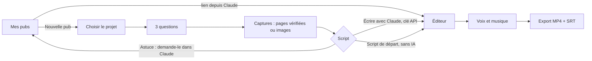

# Direction artistique

Mis à jour le 2026-10-24. Deux objets distincts :

- **Le site Weekli** (sections 1 à 7) : on garde l'existant (mesh WebGL, café et platine, maquette 3D) et on fait une passe de cohérence.
- **La pub vidéo générée pour le projet de l'utilisateur** (sections 8 et 9) : grammaire de pub de marque (niveau d'énergie et de soin de la vidéo `~/Desktop/Stepwize_pub_audit_gratuit.mp4`, qui reste une référence de niveau et non un modèle de narration), aux couleurs **du projet de l'utilisateur**, jamais à celles de Weekli.

## 1. Concept

**Site** : « Le carnet du dimanche soir ». Weekli est le moment calme où l'on relit sa semaine de code autour d'un café, avant de la raconter. Matières chaudes (moka, espresso), lumière douce (platine, lavande), typographie de magazine (serif italique pour les mots qui comptent), interface d'outil discrète. L'inverse d'un tableau de bord néon.

**Pub** : « La semaine qui recommence, jusqu'au jour où elle change ». Toute pub raconte une boucle (le problème revient), une rupture (« Et si... »), puis la sortie de la boucle grâce au projet. Le temps est le fil rouge visuel : jours, heures, semaines, repères qui défilent puis se figent sur le résultat.

## 2. Site : ce qu'on garde, ce qu'on corrige

### On garde

- Fond mesh WebGL animé (`lib/mesh.ts`), repli en dégradé CSS.
- Palette café et platine, tokens de `styles/tokens.css`.
- Duo Instrument Serif (titres, mots en italique moka) et Geist (texte), JetBrains Mono pour les noms d'outils.
- Maquette 3D de conversation Claude dans le hero, parallaxe à la souris.

### Passe de cohérence (tâche frontend F2 et F12)

| # | Constat | Correction |
|---|---|---|
| 1 | Polices chargées depuis Google (audit M4) | Polices en `woff2` dans `public/fonts/`, `styles/fonts.css` |
| 2 | Le site ne montre pas la pub vidéo, priorité 1 du brief | Nouvelle section « La pub de ton projet » avec une vraie pub exportée (voir 5) |
| 3 | « Vidéos en motion design » et format histoire encore évoqués (Fonctionnalités, README) | Remplacer par « La pub vidéo de ton projet » partout |
| 4 | Effet verre (`--verre`) utilisé un peu partout, contraste variable sur le mesh | Verre réservé aux panneaux de l'app et à la maquette du hero ; sections marketing sur fond plein ou mesh seul |
| 5 | Échelle typographique implicite (tailles en dur dans chaque module) | Tokens d'échelle (section 3) et remplacement des valeurs en dur |
| 6 | Aucun token d'espacement ni de focus | Tokens `--espace-*` et `--focus` (section 4) |
| 7 | Pages légales et Studio hors de la grille de l'accueil | Même largeur de lecture (68 caractères), mêmes titres |
| 8 | Section Chiffres : chiffres à revérifier | Uniquement des chiffres vrais et sourcés (nombre d'outils MCP, 0 € , 0 clé stockée, 90 jours) |

## 3. Typographie du site

| Rôle | Police | Graisse | Pourquoi |
|---|---|---|---|
| Titres | Instrument Serif | 400, italique pour les mots clés en moka | Voix éditoriale, chaleur du carnet, contraste fort avec l'outil |
| Texte et interface | Geist | 400, 500, 600 | Grotesque nette, très lisible petit, chiffres tabulaires |
| Noms d'outils, code | JetBrains Mono | 400, 500 | Rappel discret du monde dev, réservé aux noms d'outils |

Licences : toutes SIL OFL 1.1, hébergées localement.

Échelle (base 16 px, ratio 1,25 pour le texte, saut libre pour l'affichage) :

| Token | Taille | Interligne | Usage |
|---|---|---|---|
| `--t-affiche` | `clamp(3rem, 5.6vw, 5rem)` | 1,02 | Titre du hero |
| `--t-titre` | `clamp(2.25rem, 4vw, 3.5rem)` | 1,05 | Titres de section |
| `--t-sous-titre` | `1.5rem` | 1,2 | Titres de panneau |
| `--t-corps-grand` | `1.15rem` | 1,55 | Chapôs |
| `--t-corps` | `1rem` | 1,6 | Texte |
| `--t-petit` | `0.85rem` | 1,5 | Aides, légendes |
| `--t-etiquette` | `0.72rem`, capitales, `letter-spacing: 0.12em` | 1,3 | Surtitres |

Mesure de lecture : 68 caractères maximum.

## 4. Couleurs du site

Tokens existants conservés, contrastes vérifiés (WCAG 2.1, calcul du 2026-10-24) :

| Token | Valeur | Rôle | Contraste |
|---|---|---|---|
| `--espresso` | `#2a1c13` | Texte principal | 12,8:1 sur lavande, 13,0:1 sous platine |
| `--moka` | `#6f4e37` | Accent, mots en italique, boutons | 5,8:1 sur lavande |
| `--texte-doux` | `#6a5a4f` | Texte secondaire | 5,1:1 sur lavande |
| `--platine` | `#e5e4e2` | Fond, texte sur espresso | 13,0:1 sur espresso |
| `--lavande` | `#e6e0f0` | Fond | |
| `--lavande-pro` | `#c9bedd` | Décor, texte sur espresso | 9,3:1 sur espresso |
| `--moka-clair` | `#b89f8d` | **Décor uniquement** sur fond clair (1,9:1), texte autorisé sur espresso (6,6:1) | |
| `--danger` | `#a3392b` | Erreurs | 5,1:1 sur lavande |
| `--succes` | `#3f6b45` | Succès | 4,8:1 sur lavande |

Ajouts :

```css
--focus: 0 0 0 3px var(--platine), 0 0 0 5px var(--moka);
--espace-1: 4px; --espace-2: 8px; --espace-3: 12px; --espace-4: 16px;
--espace-5: 24px; --espace-6: 32px; --espace-7: 48px; --espace-8: 72px; --espace-9: 120px;
```

## 5. Narration de l'accueil

Ordre révisé : le connecteur Claude reste en tête (priorité 1), la pub vidéo devient la preuve visuelle.

| # | Section | Rôle | Contenu | Transition vers la suivante | Référence 21st.dev à chercher |
|---|---|---|---|---|---|
| 1 | Hero (existant) | Accroche | « Ton code de la semaine, raconté sur LinkedIn. » + maquette Claude qui appelle les outils | La maquette se termine sur un post fini ; le bandeau défile juste dessous | « hero product mockup split » |
| 2 | Bandeau (existant) | Rythme | Défilement des sujets de posts | Coupe nette vers un fond plus calme | « marquee logos » |
| 3 | La pub de ton projet (**V1**) | Solution, démonstration | Lecteur 16:9 de la pub de démonstration (sans son au départ, bouton son), trois phrases : 3 questions, Claude écrit, tu exportes | Le lecteur se réduit au scroll et laisse place aux fonctionnalités | « video showcase section » |
| 4 | Fonctionnalités (existant, textes revus) | Détail | Six capacités, dont style mémorisé et pub vidéo | Les cartes s'alignent en deux colonnes qui annoncent les deux modes | « bento features grid » (sans icônes emoji) |
| 5 | Deux modes (existant) | Choix | Claude (recommandé) ou site avec clé (bonus) | Le mode Claude est mis en avant et mène aux étapes | « pricing two columns » adapté sans prix |
| 6 | Étapes (existant) | Méthode | Connecter, lire, choisir, relire | La barre de progression se termine sur les chiffres | « timeline steps vertical » |
| 7 | Chiffres (revu) | Preuve | Uniquement des chiffres vrais (voir 2, point 8) | Le dernier chiffre « 2 minutes » amène l'installation | « stats counter » |
| 8 | Installer (existant) | Action | URL du connecteur à copier, lien vers l'app | Pied de page | « cta with code copy » |

## 6. Mouvement du site

- Vitesse : 200 à 350 ms pour l'interface, 600 à 900 ms pour les apparitions de section.
- Courbe : `--ease: cubic-bezier(0.22, 1, 0.36, 1)` en entrée ; `cubic-bezier(0.4, 0, 1, 1)` en sortie.
- Ce qui bouge : mesh (lent, continu), apparitions au scroll (une fois), maquette du hero (parallaxe légère), lecteur de la pub.
- Ce qui ne bouge pas : texte courant, formulaires, navigation, tout le studio hors aperçu.
- `prefers-reduced-motion: reduce` : mesh figé sur une image, apparitions instantanées, parallaxe coupée, pub de démonstration en pause avec affiche, aperçu du studio en pause (lecture manuelle possible).

## 7. Références du site

| Site | Ce qu'on lui emprunte |
|---|---|
| aesop.com | Palette terreuse, serif éditorial, calme et espace |
| arc.net (The Browser Company) | Dégradés chauds vivants, ton complice |
| linear.app | Retenue du mouvement, précision des alignements, vidéos produit intégrées |
| teenage.engineering | Maquettes d'objets traitées comme des pièces de musée |

## 8. Grammaire de la pub vidéo

### 8.1 Analyse d'une référence de niveau (Stepwize)

Cette vidéo est UN exemple du style dynamique voulu : elle fixe le niveau d'énergie, de finition et de rythme. Ce n'est pas une narration à recopier. L'analyse ci-dessous sert à comprendre des procédés (mots qui claquent, alternance de fonds, cartes d'interface), réutilisables dans n'importe quelle trame (8.13).

Vidéo de 58,2 s, 1920 × 1080, 30 i/s, H.264 et AAC, musique continue sous une voix off. Images extraites à 1 i/s et regardées une par une.

| Temps | Moment | Fond | Ce qu'on voit | Procédé |
|---|---|---|---|---|
| 0 à 2 s | Ouverture | Sombre de marque | Cadran circulaire qui se dessine, « LUNDI » puis « matin · 09:00 » | Mot géant au centre d'un cercle, repère temporel |
| 2 à 5 s | Répétition | Sombre | « Même réunion. » + carte d'agenda, « Même problème. » mot en rouge, « ENCORE. » plein écran rouge | Mots qui claquent, une carte d'interface, mot d'impact rouge |
| 5 s | Mur | Sombre teinté rouge | « ENCORE » géant derrière un mur de cartes identiques | Répétition visuelle |
| 6 à 9 s | Boucle | Sombre | « Semaine après semaine, le même sujet revient. » + cartes flottantes, repères « Semaine 41, 45, 49 » | Phrase mot à mot, cartes en profondeur, compteur |
| 10 à 11 s | Chorus | Sombre | « Tout le monde en parle. » entouré de bulles, puis « Personne ne le règle. » en rouge | Bulles qui apparaissent et tombent |
| 12 à 14 s | Rupture | **Clair** | « Et si quelqu'un s'en occupait, pour de vrai ? » tapé avec un curseur carré | Frappe, curseur carré de la couleur de marque |
| 15 à 21 s | Révélation | Sombre, halo et rayons | Particules carrées qui forment le logo, nom, slogan avec « qui reviennent » surligné en bloc clair, « Jusqu'au résultat. » souligné | Pixels, rayons, surlignage, soulignement |
| 22 à 36 s | Parcours | Clair | En-tête logo + onglets « 01 Comprendre... 04 Capitaliser », « ÉTAPE 01 / 04 », titre deux lignes (seconde en couleur), texte, carte d'interface qui se remplit, grand mot en filigrane (« COMPRENDRE ») | Mise en page fixe, contenu qui change, souligné d'onglet qui glisse |
| 36 à 42 s | Résultat | Clair | Frise de lundis, cartes « Retard chantier », tampon « RÉSOLU », carte « Nouveau projet », « Lundi prochain : on passe à autre chose. » | Frise qui défile, tampon, cercle de focus |
| 42 s | Transition | | Carrés sombres qui recouvrent l'écran | Transition pixels |
| 43 à 47 s | Preuve | Sombre | « Déjà utilisé avec » + trois noms séparés par des filets, puis trois cartes d'engagement | Noms qui s'empilent, cartes |
| 48 à 53 s | Appel | Clair | « Un problème revient chaque semaine ? » + badge « Premier audit GRATUIT », « Parlons-en. » lettre par lettre avec particules, bouton | Badge, lettres rebondissantes, bulle de marque en transition |
| 54 à 58 s | Fin | Sombre, rayons | Logo, nom, « Jusqu'au résultat. », bouton, site et email | Carton final |

Leçons : 1) la tension occupe le premier quart (14 s) avant de nommer le produit ; 2) le fond alterne à chaque changement d'acte, jamais au milieu d'un acte ; 3) une seule couleur d'alerte (rouge) réservée aux mots du problème ; 4) le texte à l'écran suffit sans le son ; 5) l'interface montrée est simple, en cartes blanches, jamais une capture brute plein écran.

### 8.2 Principes pour Weekli

1. **Marque de l'utilisateur partout** : couleurs, logo, nom, lien. Weekli n'apparaît pas, sauf mention « Fait avec Weekli » facultative en fin (désactivée par défaut).
2. **Valeur, pas technique** : jamais de commit, code, terminal, diff, nombre de lignes, de tests, d'étoiles ou de commits. Le visuel montre l'usage, la voix parle du quotidien de la cible.
3. **Rien d'inventé** : preuves sociales et chiffres seulement s'ils viennent des réponses de l'utilisateur ou du README. Sinon, la scène `preuve` porte des engagements vrais (gratuit, open source, sans inscription) ou disparaît.
4. **Lisible sans le son** : chaque scène a un texte à l'écran qui porte son idée.
5. **Un acte, un fond** : sombre pour la tension, la révélation, la preuve et la fin ; clair pour la rupture, le parcours, le résultat et l'appel.
6. **Une seule couleur d'alerte** pour les mots du problème, une seule couleur d'accent pour la solution.

### 8.3 Format

16:9, **1920 × 1080**, 30 i/s, durée cible **60 s** (50 à 65 s acceptés). MP4 H.264 (débit environ 8 Mb/s) et AAC 48 kHz stéréo 192 kb/s ; repli WebM VP9 et Opus. Sous-titres `.srt` à part.

Grille : marges latérales 120 px, haut et bas 96 px ; 12 colonnes de 120 px, gouttière 24 px. Zone de sécurité : rien d'important à moins de 64 px des bords (recadrages des lecteurs).

### 8.4 Palette dérivée de la marque

L'utilisateur (ou Claude) donne `primaire`, éventuellement `accent` et `alerte`. `paletteDepuisMarque` (core, testé) calcule en OKLCH, avec H et C la teinte et la chroma de `primaire` :

| Rôle | Calcul | Contrôle |
|---|---|---|
| `sombre` | oklch(0,20 ; min(C, 0,14) ; H) | |
| `sombreHalo` | oklch(0,34 ; min(C, 0,20) ; H), centre du dégradé radial | |
| `clair` | oklch(0,975 ; min(C, 0,012) ; H) | |
| `encre` (texte sur clair) | oklch(0,20 ; min(C, 0,06) ; H) | au moins 12:1 sur `clair` |
| `encreDouce` | oklch(0,48 ; min(C, 0,04) ; H) | luminosité baissée jusqu'à 4,5:1 sur `clair` |
| `accentClair` (accent sur fond clair) | `accent` ou `primaire`, luminosité baissée par pas de 0,02 | jusqu'à 4,5:1 sur `clair` |
| `accentSombre` (accent sur fond sombre) | même teinte, luminosité montée | jusqu'à 4,5:1 sur `sombre` |
| `alerteSombre` | `alerte` (défaut `#e5484d`), luminosité montée | jusqu'à 4,5:1 sur `sombre` |
| `alerteClair` | `alerte` | 3:1 minimum sur `clair` : réservée aux textes de 48 px et plus |
| `blanc` | `#ffffff` | texte sur `sombre` |
| `rayons` | `accentSombre` à 18 % d'opacité | décor |
| `surface` | `#ffffff` | cartes sur fond clair |

Cas particuliers : marque presque grise (C < 0,03) : l'accent par défaut est la couleur la plus saturée extraite de la capture, sinon `#3d4bff`. Le paramètre optionnel `accentParDefaut` de `paletteDepuisMarque` reçoit cette couleur extraite (le navigateur la fournit) ; sans lui, `#3d4bff`. Les règles ci-dessus priment ; l'ajustement s'arrête dès le seuil de contraste atteint, sans le dépasser. Exemple calculé par `paletteDepuisMarque` pour `primaire #3d4bff` : `sombre #08004f`, `sombreHalo #1c169c`, `clair #f4f7ff`, `encre #0c1331` (17,0:1), `encreDouce #555d75` (6,1:1), `accentClair #3d4bff` (5,4:1), `accentSombre #5773ff` (4,7:1), `alerteSombre #e5484d` (4,8:1 sur sombre), `alerteClair #e5484d` (3,7:1 sur clair), `rayons rgba(87, 115, 255, 0.18)`. Un `accent` ou une `alerte` invalide dans le script est ignoré avec un avertissement (un `primaire` invalide est rejeté).

Origine des couleurs, par ordre de priorité : 1) choix de l'utilisateur dans le studio ; 2) proposition de Claude dans le script (il a vu la capture) ; 3) extraction automatique dans le studio : quantification des pixels de la première capture (k-moyennes, k = 6), on écarte les quasi-blancs et quasi-noirs, on propose les 3 couleurs les plus saturées et fréquentes.

### 8.5 Typographie de la pub

Deux ambiances (`marque.typo`), polices déjà hébergées par le site :

| Ambiance | Affichage | Accent | Texte et étiquettes | Pour |
|---|---|---|---|---|
| `nette` (défaut) | Geist 800, `letter-spacing: -0.045em` | Même police, couleur d'accent | Geist 500, étiquettes Geist 600 capitales `+0.14em` | Outils, services, B2B |
| `editoriale` | Instrument Serif 400 | Instrument Serif italique | Geist 500 et 600 | Projets culturels, artisanaux, personnels |

Échelle à 1080p :

| Niveau | Taille | Interligne | Usage |
|---|---|---|---|
| Impact | 240 px | 0,9 | « ENCORE. », mot d'impact |
| Affiche | 160 px | 0,95 | Moment d'ouverture, nom du projet |
| Grand | 104 px | 1,02 | Phrases d'acte (rupture, chorus, appel) |
| Titre | 76 px | 1,04 | Titres d'étape et de résultat |
| Slogan | 44 px | 1,2 | Slogan, chute |
| Texte | 30 px | 1,35 | Texte d'étape |
| Carte | 22 px | 1,35 | Contenu des cartes |
| Étiquette | 20 px, capitales | 1,2 | « ÉTAPE 01 / 04 », surtitres |
| Filigrane | 300 px, contour 2 px | 1 | Grand mot d'arrière-plan à 7 % d'opacité |

Retour à la ligne automatique par mesure ; si un texte dépasse, la taille baisse par pas de 4 % jusqu'à 80 % de l'échelle, puis le texte est coupé avec points de suspension et un avertissement apparaît dans l'éditeur.

### 8.6 Fonds et motifs

- **Fond sombre de marque** : `sombre` uni, halo radial `sombreHalo` centré (rayon 70 % de la largeur) qui respire (±4 % d'intensité, période 6 s), grain fin (bruit à 3 % d'opacité, figé par image pour éviter le scintillement à l'encodage).
- **Fond clair** : `clair` uni, grille de points `encre` à 6 % d'opacité (pas de 32 px).
- **Motif de carrés** (les deux fonds) : 14 à 20 carrés de 12 à 56 px, coins arrondis 4 px, opacité 4 à 10 %, qui dérivent lentement (8 à 20 px/s) et changent de position à chaque scène. Ils rappellent les pixels de la révélation et donnent de la profondeur.
- **Rayons** (révélation, fin) : 16 rayons depuis le centre, alternance pleine et vide, rotation lente (6°/s), couleur `rayons`, masque radial qui les fond vers les bords.

### 8.7 Typographie cinétique

| Procédé | Règle |
|---|---|
| Mot par mot | Chaque mot sort d'un masque par le bas (décalage 0,5 em, opacité 0 vers 1), 260 ms, décalage de 70 ms entre mots, courbe `easeOutExpo` |
| Accent | La partie `accent` d'un `MotsAccent` passe à la couleur d'accent (ou d'alerte dans les scènes de tension), avec un léger rebond d'échelle 1,06 vers 1 en 180 ms |
| Surlignage | Bloc `clair` (sur fond sombre) ou `accentClair` à 14 % (sur fond clair) qui balaie de gauche à droite derrière la partie accentuée en 320 ms, le texte change de couleur au passage |
| Soulignement | Filet de 4 px qui se dessine sous la signature en 400 ms |
| Frappe | Caractère par caractère (40 ms), curseur carré plein `accentClair` de 0,6 em, clignement 530 ms, qui saute à la ligne avec le texte |
| Impact | Mot d'impact : échelle 1,25 vers 1 en 160 ms, décalage chromatique (rouge et cyan à ±6 px) pendant 4 images, micro-secousse du cadre ±6 px sur 6 images |
| Lettres | « Action » de l'appel : lettres qui tombent de 80 px avec rebond (amortissement 0,5), 45 ms d'écart, 6 particules carrées par lettre qui s'échappent |
| Sortie | Les textes ne sortent pas mot par mot : la transition de scène les emporte |

### 8.8 Transitions

Chaque transition d'entrée dure de 0,25 à 0,6 s et chevauche la fin de la scène précédente.

| Transition | Durée | Rendu | Défaut pour |
|---|---|---|---|
| `coupe` | 0 s | Changement net, calé sur le temps fort de la musique | `ouverture`, `repetition`, étapes 2 à 4 |
| `glitch` | 0,3 s | 6 à 10 tranches horizontales décalées (±80 px), décalage RVB ±12 px, 2 images de bruit, puis la nouvelle scène | `boucle`, `rupture`, `appel` |
| `flou` | 0,5 s | Ancienne scène floue (0 à 24 px) et agrandie (1 à 1,08), nouvelle scène qui passe de floue à nette | `chorus`, première `etape`, `resultat`, `fin` |
| `pixels` | 0,6 s | Grille de carrés de 64 px aux couleurs du fond suivant, qui couvrent l'écran en vague depuis le centre puis s'effacent en sens inverse | `revelation`, `preuve` |

Sans `ctx.filter` disponible, `flou` devient un fondu enchaîné avec agrandissement.

### 8.9 Catalogue des scènes

Durées en secondes : minimum, défaut, maximum. La durée réelle suit la voix (architecture, section 7). `t` désigne le temps local de 0 à 1.

| Type | Acte | Fond | Durées | Champs (voir `api-contract.md` 2.1) | Animation |
|---|---|---|---|---|---|
| `ouverture` | Tension | Sombre | 1,8 / 2,5 / 3,5 | `moment`, `detail?` (accroche : repère de temps, question, chiffre réel, citation ou contraste Avant/Après, voir 8.13) | Un cercle fin se dessine (t 0 à 0,4) avec graduations ; `moment` en Affiche apparaît en échelle 0,9 vers 1 (t 0,15) ; `detail` en Slogan couleur `accentSombre` (t 0,4). Le cercle tourne lentement |
| `repetition` | Tension | Sombre | 2,5 / 3,5 / 5 | `lignes[2..3]`, `impact`, `carte?` | Chaque ligne en Grand, partie accentuée en `alerteSombre`, une ligne chasse l'autre (montée de 40 px). La carte (blanche, 420 px) glisse à droite sur la première ligne. Dernier quart : `impact` en Impact plein écran `alerteSombre`, fond légèrement rougi, puis mur de 24 cartes identiques derrière, à 30 % |
| `boucle` | Tension | Sombre | 3 / 4 / 5,5 | `phrase`, `reperes[2..4]`, `carte` | Phrase mot à mot en haut ; 5 à 7 copies de la carte flottent en profondeur (échelles 0,6 à 1,1, flou selon la profondeur) ; une pastille en bas affiche les repères qui se succèdent ; à chaque repère, une carte avance au premier plan |
| `chorus` | Tension | Sombre | 3 / 4 / 5,5 | `titre`, `chute`, `bulles[3..6]` | `titre` au centre en Grand, bulles blanches (22 px) qui apparaissent autour en ressort, puis tombent en tournant ; `chute` remplace le titre, accent en `alerteSombre` |
| `rupture` | Rupture | Clair | 2,5 / 3,5 / 4,5 | `texte` | Frappe en Grand couleur `encre`, partie accentuée en `accentClair`, curseur carré. Silence musical de 0,4 s au début (la musique repart à la révélation) |
| `revelation` | Révélation | Sombre, halo, rayons | 4,5 / 6 / 7,5 | `slogan`, `signature?` (le nom vient de `projet.nom`) | t 0 à 0,25 : 300 particules carrées convergent et forment le logo (ou le monogramme pixel), rayons qui s'ouvrent, onde et impact sonore ; t 0,25 : nom en Affiche blanc à droite du logo ; t 0,45 : slogan mot à mot, partie accentuée surlignée ; t 0,7 : signature en Slogan soulignée. Légère poussée de caméra (échelle 1 vers 1,04) |
| `etape` | Parcours | Clair | 3,5 / 4,5 / 6 | `onglet`, `filigrane`, `titre`, `texte?`, `visuel` | Gabarit fixe partagé par toutes les étapes : en-tête (logo 28 px + nom à gauche, onglets de toutes les étapes à droite, souligné qui glisse vers l'onglet actif en 0,4 s). Colonne gauche (colonnes 1 à 5) : « ÉTAPE 0n / 0N » en Étiquette `accentClair`, titre en Titre (seconde ligne `accentClair`), texte en Texte `encreDouce`. Colonne droite (colonnes 7 à 12) : la carte (voir 8.10). Filigrane en bas, contour `encre` 7 %, défile horizontalement (40 px/s). Une étape portée par une capture est un clin d'œil de 2,5 s au plus, but `montrer`, voix de 5 mots (8.10) ; 2 captures au plus par pub |
| `transformation` | Parcours | Clair | 3,5 / 4,5 / 6 | `titre`, `entree{icone,libelle}`, `operateur`, `sortie{icone,libelle}`, `texte?` | Une tuile d'entrée glisse dans un anneau, éclate en 36 carrés et se réassemble en tuile de sortie : une donnée devient un résultat (spécification complète en 8.17) |
| `flux` | Parcours | Clair | 4 / 5 / 6,5 | `titre`, `noeuds[3]{icone,libelle,detail?}` | Trois tuiles à icône reliées par des rails qu'une impulsion parcourt, la dernière se remplit (8.17) |
| `avantapres` | Parcours | Clair | 3,5 / 4,5 / 6 | `titre`, `avant?`, `apres?`, `paires[2..3]{avant,apres}` | Un panneau passe de l'état « avant » à l'état « après » : un filet le balaie et les lignes se retournent lettre à lettre (8.17) |
| `resultat` | Résultat | Clair | 4 / 5 / 6,5 | `titre`, `avant`, `tampon`, `apres`, `chute?` | Surtitre « RÉSULTAT » ; titre en Titre ; frise de 6 cartes datées qui défile vers la gauche : les 3 premières portent `avant` avec pastille `alerteClair`, la 4e reçoit le tampon (`tampon` en capitales, cadre arrondi incliné de -8°, écrasement 1,3 vers 1 et petite secousse), la 5e est une carte pleine `accentClair` portant `apres`, la 6e un point d'interrogation pâle. Cercle de focus fin autour du tampon. `chute` en Slogan en bas |
| `preuve` | Preuve | Sombre | 3,5 / 4,5 / 6 | `surtitre`, `elements[1..4]`, `cartes[0..3]?` | Surtitre en Étiquette ; chaque élément en Grand blanc s'empile avec un filet `blanc` 12 % dessous ; les cartes (fond `sombreHalo`, bord 1 px blanc 10 %) entrent à droite décalées de 120 ms |
| `appel` | Action | Clair | 4 / 5 / 6,5 | `question`, `badge?`, `action`, `bouton` | Question en Grand centrée, accent `accentClair` ; badge en pilule blanche ombrée, partie accentuée dans un bloc `accentClair` texte blanc ; `action` en Affiche, lettres qui tombent ; bouton pilule `accentClair` avec flèche qui glisse. Sortie : bulle `sombre` qui grandit depuis le bouton |
| `fin` | Fin | Sombre, rayons | 3 / 4 / 5 | `slogan?`, `bouton?`, `liens[1..2]`, `mentionWeekli?` | Logo et nom au centre (sans réanimation des pixels), slogan en Slogan, bouton pilule blanche texte `sombre`, liens en Texte blanc 70 %. Rien ne bouge les 1,5 dernières secondes hormis les rayons |

### 8.10 Des captures aux cartes animées

L'interface de l'utilisateur ne peut pas être redessinée : on la montre par ses captures, traitées comme des cartes d'interface.

**Rares et brèves (décision de Soufiane, 2026-10-25).** Les gens n'ont pas le temps de lire un écran et peuvent aller sur le site. Une capture est donc un clin d'œil, jamais une explication (l'explication est confiée à 8.17) :

| Règle | Valeur | Contrôle |
|---|---|---|
| Nombre | 2 scènes-capture au plus par pub (`LIMITES_PUB.capturesScene.max`), facultatives | Au-delà, la scène passe en liste vide et un avertissement conseille une scène d'explication |
| Durée | 2,5 s au plus (1,8 s au moins) | `dureeScene` borne l'étape-capture ; `duree` est ramenée à 2,5 s |
| But | Toujours `montrer` (pause de lecture de 0,5 s) | Un autre but est remplacé, avec un avertissement |
| Voix | 5 mots au plus (la scène ne peut pas durer plus que sa voix) | Avertissement au-delà |
| Chronologie | 0 à 0,4 s : la carte entre (montée de 40 px, échelle 0,94 vers 1, `easeOutExpo`) ; 0,4 à 2,1 s : Ken Burns lent ; le `focus`, s'il est donné, s'encadre à 0,9 s sans assombrir l'extérieur plus qu'à 55 % ; pas de vignette secondaire | |
| Texte | Le titre et le `texte` restent courts : l'écran n'a pas à être lu en entier | |

Le tableau ci-dessous décrit la carte elle-même.

| Élément | Règle |
|---|---|
| Source | `POST /api/captures` (domaine vérifié, floutage automatique) ou image importée (locale) |
| Cadrage | `haut` (0 à 55 % de la hauteur), `milieu` (25 à 80 %), `bas` (45 à 100 %), `complet`, ou rectangle libre en fractions. Le rapport du cadre est respecté, la carte s'adapte entre 4:3 et 16:10 |
| Carte bureau | Surface blanche, rayon 20 px, barre de navigateur de 40 px (trois points `encreDouce` 30 %, pilule d'adresse avec le domaine), ombre `0 40px 80px -30px` couleur `sombre` à 35 %, largeur 760 à 880 px |
| Carte mobile | Cadre de téléphone arrondi (rayon 48 px, bord 10 px `encre`), 340 px de large, légèrement incliné (-4°) |
| Entrée | Montée de 60 px, échelle 0,94 vers 1, opacité, 500 ms, `easeOutExpo` (400 ms et 40 px pour une capture brève, voir plus haut) |
| Vie | Lent Ken Burns : échelle 1 vers 1,05 et glissement vers le centre du `focus` (ou du cadre) sur toute la scène |
| Focus | Si `focus` est donné : à t 0,45, l'extérieur du rectangle s'assombrit à 35 %, un cadre `accentClair` de 3 px se dessine autour, la carte zoome légèrement vers lui (1,05 vers 1,12) |
| Vignettes | Hors capture brève : si deux captures sont disponibles, la seconde apparaît en petite carte (360 px) décalée en bas à gauche de la première, avec 150 ms de retard (effet de profondeur) |
| Sans capture | `visuel: liste` : carte blanche titrée, 2 à 4 lignes avec case, les cases se cochent une à une (`accentClair`), barre de progression qui se remplit. Cas limite : une scène `etape` dont la capture est inconnue passe en liste vide (`elements: []`) ; le moteur affiche alors seulement le titre de l'étape, sans carte. Le script de départ ne produit jamais ce cas : chaque `etape` y porte soit une capture existante, soit une liste de 2 à 4 éléments |
| Interdits | Capture brute plein écran, capture d'un terminal, d'un éditeur de code ou de GitHub |

### 8.11 Logo du projet

- `monogramme` (défaut) : 1 ou 2 caractères en Geist 800 rastérisés sur une grille de 9 × 9 cellules ; chaque cellule pleine devient un carré arrondi `accentSombre` (sur sombre) ou `accentClair` (sur clair). C'est ce motif que les particules de la révélation construisent.
- `image` : SVG, PNG ou WebP importé dans le studio (512 Ko max), conservé dans IndexedDB, jamais envoyé au serveur. Pour la révélation, l'image est échantillonnée en grille de 24 × 24 (canal alpha) pour guider les particules, puis l'image réelle apparaît en fondu à t 0,25. Hauteur 120 px dans la révélation, 28 px dans l'en-tête des étapes.
- Si un script avec `logo: "image"` est ouvert sur un appareil sans le fichier, le monogramme est utilisé et l'éditeur le signale.

### 8.12 Voix off et musique

- Voix féminine française (ADR-07 de l'architecture), débit pub, 120 à 170 mots pour 60 s.
- Écriture pour l'oreille : phrases de 12 mots au plus, nombres en toutes lettres, aucune parenthèse, aucun sigle non déclaré dans `prononciation`, aucun tiret long.
- Vouvoiement par défaut (la pub s'adresse aux clients du projet) ; tutoiement si les réponses de l'utilisateur l'indiquent.
- La voix ne lit pas l'écran : elle dit l'idée, l'écran en garde les mots clés.
- Musique générée (`energique` par défaut) : 112 bpm, coupes et impacts calés sur les temps ; silence de 0,4 s sur la rupture, impact grave sur la révélation, montée finale sur l'appel. La musique baisse de 9 dB sous la voix.

### 8.13 Trames narratives et structure type

Chaque pub suit l'une de trois **trames**, inscrite dans le champ `trame` du script (facultatif). Une trame est un ordre de scènes avec ses durées, pas un modèle de texte : accroches, mots et rythme viennent du projet. Règle : **varier, ne jamais copier une référence**. Deux pubs successives ne doivent ni partir de la même accroche ni suivre le même ordre. Le moteur et les types de scènes ne changent pas.

**Accroches possibles** (scène `ouverture`) : repère de temps du quotidien (« Samedi »), question courte, chiffre réel (seulement s'il vient de l'utilisateur ou du README), citation (seulement si l'utilisateur la fournit), contraste « Avant / Après », conviction (« Notre idée »). Le repère de temps est une option parmi d'autres, jamais un passage obligé.

| Trame | Ordre des scènes | Durée | Quand l'utiliser |
|---|---|---|---|
| `probleme-qui-revient` | `ouverture` 2,5, `repetition` 3,5, `boucle` 4, `chorus` 4 (facultative), `rupture` 3,5, `revelation` 6, parcours de 2 à 4 scènes (4,5 ; `transformation`, `flux`, `avantapres`, `etape`), `resultat` 5, `preuve` 4,5 (facultative), `appel` 5, `fin` 4 | 55 à 60 s | Un irritant précis et répété dans le quotidien de la cible. La répétition est le propos et doit être vraie dans les réponses. Tension sur le premier quart. |
| `demonstration-directe` | `ouverture` 2,5 (contraste Avant/Après ou question), `revelation` 6, parcours de 3 à 4 scènes (4,5 ; `transformation`, `flux`, `avantapres` et au plus une capture brève), `resultat` 5, `preuve` 4,5 (facultative), `appel` 5, `fin` 4 | 50 à 55 s | Un produit qui s'explique par son fonctionnement (une transformation, un flux, un avant et un après). Pas de tension longue : la révélation tombe avant 6 s, le reste est l'usage. Les captures ne sont plus nécessaires. |
| `vision-manifeste` | `ouverture` 2,5 (« Notre idée », citation ou chiffre réel), `rupture` 3,5 (la conviction tapée), `revelation` 6, parcours de 2 à 4 scènes (4,5), `preuve` 4,5 (facultative), `resultat` 5, `appel` 5, `fin` 4 | 50 à 58 s | Un projet porté par une conviction (liberté, vie privée, ouvert, respect) ou un projet personnel ou culturel : le propos est un principe, pas une répétition. La preuve vient de l'usage et des engagements réels. |

**Choix de la trame par `scriptPubDepuisReponses`** (heuristique sans IA, `choisirTrame`, sur les réponses en minuscules sans accents) :

1. Mot de conviction (croire, mériter, devoir, liberté, libre, vie privée, open source, indépendant, éthique, respect) dans le problème ou la promesse : `vision-manifeste`.
2. Sinon, mot de répétition dans le problème (toujours, encore, chaque, revient, même, perd, oubli, retard, sonne...) ou aucune capture : `probleme-qui-revient`.
3. Sinon : `demonstration-directe`.

Une trame passée dans l'entrée (`trame`) l'emporte, sauf `demonstration-directe` sans aucune capture, remplacée par `probleme-qui-revient` (le script de départ ne sait pas écrire un parcours de 4 scènes sans un clin d'œil de capture pour tenir 50 s ; un auteur humain ou Claude peut, lui, tenir avec 3 scènes d'explication et plus de voix). Claude, qui rédige le script en mode MCP ou clé API, choisit lui-même la trame d'après les 3 réponses et la même table ; l'heuristique ne sert qu'au script de départ du studio.

#### Structure de la trame `probleme-qui-revient`

La durée d'une scène inclut sa zone de chevauchement avec la précédente (8.8). La durée totale est donc la somme des durées moins la somme des chevauchements : avec toutes les scènes facultatives et 4 étapes, 60 s de durées cumulées donnent 55,9 s de pub. Le cumul net ci-dessous soustrait les chevauchements. Il reste dans la fenêtre d'avertissement de 50 à 65 s.

| # | Scène | Durée | Chevauchement | Cumul net | Voix (mots) |
|---|---|---|---|---|---|
| 1 | `ouverture` | 2,5 | 0 | 2,5 | 5 |
| 2 | `repetition` | 3,5 | 0 | 6 | 6 |
| 3 | `boucle` | 4 | 0,3 | 9,7 | 14 |
| 4 | `chorus` (facultative) | 4 | 0,5 | 13,2 | 8 |
| 5 | `rupture` | 3,5 | 0,3 | 16,4 | 9 |
| 6 | `revelation` | 6 | 0,6 | 21,8 | 10 |
| 7 à 10 | Parcours de 3 à 4 scènes (`transformation`, `flux`, `avantapres`, `etape`) | 4,5 × 4 (une capture : 2,5) | 0,5 puis 0 | 39,3 | 4 × 13 (une capture : 5) |
| 11 | `resultat` | 5 | 0,5 | 43,8 | 11 |
| 12 | `preuve` (facultative) | 4,5 | 0,6 | 47,7 | 12 |
| 13 | `appel` | 5 | 0,3 | 52,4 | 12 |
| 14 | `fin` | 4 | 0,5 | 55,9 | 5 |

### 8.14 Les 3 questions

Posées par Claude (outil `preparer_pub`) ou par le studio, avant toute écriture :

| Clé | Question | Aide affichée | Ce qu'elle nourrit |
|---|---|---|---|
| `pourQui` | Pour qui est ton projet ? | Décris la personne et son quotidien, pas la technique. Exemple : les restaurateurs qui prennent les réservations au téléphone pendant le service. | `ouverture` (le moment), le vouvoiement, `appel` (la question) |
| `probleme` | Quel problème lui règles-tu ? | Ce qui revient, ce qui agace, ce qui coûte. Exemple : le téléphone sonne en plein service et les réservations se perdent. | `repetition`, `boucle`, `chorus`, `rupture` |
| `promesse` | Que lui promets-tu ? | Le résultat en une phrase, sans jargon. Exemple : les réservations arrivent toutes seules, le service reste calme. | `revelation` (slogan), `resultat`, `fin` |

Le README, la description du repo et les captures nourrissent les étapes ; rien de technique n'en est repris.

### 8.15 Exemple complet (projet fictif)

Projet inventé pour illustrer le format : « Tablée », réservations en ligne pour petits restaurants. Voix de 140 mots, durée estimée de 51,6 s (12 scènes, chevauchements soustraits) : `nettoyerScriptPub` ne renvoie aucun avertissement. Il respecte les règles de 8.10 (deux captures brèves, voix de 5 mots, but `montrer` posé par le moteur) et de 8.18 (chaque argument une fois). Il date d'avant les scènes d'explication de 8.17, qui illustrent mieux le fonctionnement qu'une capture ; la pub de Weekli (`apps/web/dev/pub-weekli.json`) en montre une de chaque.

```json
{
  "version": 1,
  "titre": "Pub Tablée",
  "projet": {"nom": "Tablée", "repo": "tablee", "lien": "https://tablee.example"},
  "reponses": {
    "pourQui": "Les restaurateurs indépendants qui prennent les réservations au téléphone pendant le service.",
    "probleme": "Le téléphone sonne en plein coup de feu, les réservations se perdent sur un carnet, des tables restent vides.",
    "promesse": "Les réservations arrivent toutes seules et le service reste calme."
  },
  "marque": {"primaire": "#c2410c", "accent": "#ea580c", "logo": "monogramme", "monogramme": "T", "typo": "nette"},
  "voix": {"mode": "synthese", "vitesse": 1, "prononciation": {"Tablée": "Tablé"}},
  "musique": "energique",
  "captures": [
    {"id": "accueil", "source": "site", "url": "https://tablee.example/", "format": "bureau", "legende": "Accueil"},
    {"id": "salle", "source": "site", "url": "https://tablee.example/demo/salle", "format": "bureau", "legende": "Plan de salle"}
  ],
  "scenes": [
    {"id": "ouverture", "type": "ouverture", "moment": "Samedi", "detail": "20:30 · coup de feu", "voix": "Samedi soir, vingt heures trente. La salle déborde de monde."},
    {"id": "repetition", "type": "repetition", "lignes": [{"texte": "Même carnet.", "accent": "carnet."}, {"texte": "Même téléphone.", "accent": "téléphone."}], "impact": "ENCORE.", "carte": {"titre": "Appel manqué", "detail": "Table pour 4, 21:00"}, "voix": "Le téléphone sonne. Encore. Et les mains sont prises, une fois de plus."},
    {"id": "boucle", "type": "boucle", "phrase": {"texte": "Service après service, les mêmes tables vides.", "accent": "tables vides."}, "reperes": ["Vendredi", "Samedi", "Dimanche"], "carte": {"titre": "Réservation perdue", "detail": "Rappeler ?"}, "voix": "Service après service, les réservations se perdent sur un carnet, et des tables restent vides."},
    {"id": "chorus", "type": "chorus", "titre": {"texte": "Tout le monde décroche.", "accent": "décroche."}, "chute": {"texte": "Personne ne note.", "accent": "ne note."}, "bulles": ["C'est pour quand ?", "Vous avez mon nom ?", "On était quatre.", "Je rappelle plus tard."], "voix": "Tout le monde décroche, mais personne ne note. Les clients rappellent, encore et encore."},
    {"id": "rupture", "type": "rupture", "texte": {"texte": "Et si les réservations arrivaient toutes seules ?", "accent": "toutes seules ?"}, "voix": "Et si les réservations arrivaient toutes seules, sans appel ?"},
    {"id": "revelation", "type": "revelation", "slogan": {"texte": "Vos réservations, sans le téléphone.", "accent": "sans le téléphone."}, "signature": "Plus de calme, moins de bruit.", "voix": "Voici Tablée. Vos réservations en ligne, sans le téléphone, pour un service serein."},
    {"id": "etape-reserver", "type": "etape", "onglet": "Réserver", "filigrane": "RÉSERVER", "titre": {"texte": "Le client réserve en ligne.", "accent": "en ligne."}, "texte": "Un lien sur Google, Instagram ou votre site.", "visuel": {"type": "capture", "capture": "accueil", "cadrage": "haut"}, "voix": "Vos clients réservent en ligne."},
    {"id": "etape-confirmer", "type": "etape", "onglet": "Confirmer", "filigrane": "CONFIRMER", "titre": {"texte": "Tout est confirmé pour vous.", "accent": "pour vous."}, "texte": "Un message part la veille et le jour même.", "visuel": {"type": "liste", "titre": "Rappels", "elements": ["Confirmation envoyée", "Rappel la veille", "Table attribuée"]}, "voix": "La confirmation et le rappel partent tout seuls, la veille et le jour même, sans que personne y pense."},
    {"id": "etape-servir", "type": "etape", "onglet": "Servir", "filigrane": "SERVIR", "titre": {"texte": "Votre salle, d'un coup d'œil.", "accent": "d'un coup d'œil."}, "visuel": {"type": "capture", "capture": "salle", "cadrage": "milieu", "focus": {"x": 0.55, "y": 0.3, "largeur": 0.3, "hauteur": 0.35}}, "voix": "Votre salle, d'un coup d'œil."},
    {"id": "resultat", "type": "resultat", "titre": {"texte": "Le service reste calme.", "accent": "calme."}, "avant": "Appel manqué", "tampon": "Réservé", "apres": "Table pleine", "chute": {"texte": "Le week-end prochain : complet.", "accent": "complet."}, "voix": "Résultat : moins d'appels, plus de tables remplies, un week-end complet."},
    {"id": "appel", "type": "appel", "question": {"texte": "Encore un samedi au téléphone ?", "accent": "au téléphone ?"}, "badge": {"texte": "Premier mois offert", "accent": "offert"}, "action": "Essayez.", "bouton": "Ouvrir mon carnet numérique", "voix": "Encore un samedi au téléphone ? Le premier mois est offert, sans engagement. Essayez."},
    {"id": "fin", "type": "fin", "slogan": "Le service reste calme.", "bouton": "Essayer Tablée", "liens": ["tablee.example"], "voix": "Tablée. Le service reste calme, soir après soir, pour toute l'équipe."}
  ]
}
```

Dans cet exemple, la scène `preuve` est absente : le projet fictif n'a aucune preuve réelle à montrer, et on n'en invente pas.

### 8.16 Discipline de production

Décision de Soufiane (2026-10-25) : on garde le niveau d'énergie de la référence ainsi que la voix Vivienne (la structure narrative, elle, varie selon la trame, 8.13), et on adopte, pour la discipline, la méthode d'un skill de motion design externe (matériau de lecture, rien n'en est exécuté). Cette section prime sur 8.7 et 8.8 quand elles se contredisent.

**Identité et mouvement tirés du projet.** Couleurs, logo, nom et lien viennent du projet de l'utilisateur (8.4, 8.11). La typographie suit `marque.typo` : `nette` pour une interface rigoureuse, `editoriale` pour un univers plus humain. Le caractère du mouvement suit la même clé : `nette` donne des transformations sobres (ressorts amortis, peu de rebond), `editoriale` un rythme plus organique (rebonds plus marqués, décalages plus longs). Un dépassement ne coupe jamais un mot ni ne sort une carte du cadre.

**Gestes : 2 ou 3 par pub.** La bibliothèque contient dix gestes, identifiés par :

| Identifiant | Geste | Défini en |
|---|---|---|
| `accent` | Mots clés en couleur d'accent ou d'alerte, rebond 1,06 | 8.7 |
| `surlignage` | Bloc qui balaie derrière le mot accentué | 8.7 |
| `soulignement` | Filet sous la signature | 8.7 |
| `frappe` | Texte tapé avec curseur carré | 8.7 |
| `impact` | Mot d'impact, décalage chromatique, secousse | 8.7 |
| `lettres` | Mot d'action en lettres qui tombent et particules | 8.7 |
| `glitch`, `flou`, `pixels` | Transitions de scène | 8.8 |
| `rayons` | Rayons de la révélation et de la fin | 8.6 |

Le script porte un champ facultatif `gestes` (2 à 3 identifiants distincts). Le moteur n'applique que ces gestes : un geste non choisi est remplacé par sa version neutre (accent sans rebond, `impact` en simple changement d'échelle, `lettres` en mot par mot, `frappe` en mot par mot, `surlignage` en couleur de texte, `soulignement` omis, transition en `coupe`, `rayons` en halo fixe). Le mot par mot, la `coupe`, les fonds et le motif de carrés ne sont pas des gestes : ils sont toujours présents. Sans `gestes`, le moteur applique les défauts du catalogue 8.9 (comportement actuel). Un geste explique un changement, puis se stabilise ; l'objet qui se déplace garde sa forme d'une scène à l'autre.

Choix conseillé : un projet sobre prend `accent`, `soulignement` et `flou` ; un projet nerveux prend `impact`, `glitch` et `lettres`. Une transition explicite (`glitch`, `flou`, `pixels`) hors des gestes choisis donne un avertissement de `nettoyerScriptPub`.

**But d'une scène : `lire`, `comprendre`, `montrer`.** Champ facultatif `but` sur chaque scène, qui règle la pause de lecture, c'est-à-dire le temps immobile après la fin des gestes d'entrée :

| But | Contenu | Pause de lecture minimale | Traitement |
|---|---|---|---|
| `lire` | Message indispensable | 1,2 s | Rien ne bouge sauf le fond ; texte court |
| `comprendre` | Schéma, parcours | 0,8 s | On laisse voir la relation puis son résultat |
| `montrer` | Capture (2,5 s au plus, 2 par pub), carton, exemple dense | 0,5 s | Exposition brève possible, contenu jamais raccourci |

But par défaut : `lire` pour `ouverture`, `repetition`, `chorus`, `rupture`, `revelation`, `preuve`, `appel` ; `comprendre` pour `boucle`, `etape`, `transformation`, `flux`, `avantapres`, `resultat` ; `montrer` pour `fin`. Une étape portée par une capture prend toujours `montrer` (8.10). La pause prolonge la scène dans ses bornes de 8.9 sans ralentir les gestes. Quand la voix est plus courte que gestes plus pause, la durée de la scène suit gestes plus pause (dans les bornes). Un seul calendrier régit scènes, transitions et repères audio.

**Image zéro complète et miniature.** La première image est un état complet : logo ou monogramme lisible, titre utile, bon contraste, rien à moitié entré. Le moteur rend donc l'ouverture avec le logo et le nom déjà posés dès t = 0 (pas de fondu depuis le noir). Une miniature PNG au ratio de la vidéo (1920 x 1080) est livrée avec le MP4 : elle reprend l'image zéro avec le titre de la pub, jamais une image prise au hasard. Il ne faut pas promettre qu'une plateforme l'utilisera automatiquement.

**Honnêteté : réel et illustratif.**
- Une animation n'est jamais présentée comme une démonstration réelle. Ni la voix, ni les textes à l'écran ne disent « en direct », « en vrai » ou « démonstration ».
- Réel : les captures du site et les engagements vérifiables du projet (README). Illustratif : les cartes, listes, frises, tampons, bulles et situations. Le studio marque les cartes illustratives par une mention discrète « Illustration » dans la planche de relecture, et la note de contrôles la rappelle.
- Pas de preuve, de chiffre, de client ni d'offre inventés (8.2, point 3).

**Contrôles finaux** (le moteur les exécute après l'export, F10) :
1. Images intermédiaires aux raccords : une image à chaque milieu de transition et deux images à t0 + 0,2 s et t1 - 0,2 s de chaque scène, en plus des extrémités. On cherche texte coupé, accent faux, carte hors cadre, sprite étiré.
2. Crête vraie (true peak) du fichier AAC final sous -1,5 dBTP ; niveau intégré visé -16 LUFS. Mesure refaite après toute modification du son.
3. Aucun noir involontaire : sur le MP4 décodé, aucune image dont la luminance moyenne est inférieure à 2 % hors des fonds sombres de marque, et aucune plage de plus de 0,2 s ; le fond sombre `sombre` n'est pas un noir.
4. Durée, dimensions, cadence et présence de la piste audio conformes au plan ; durée audio égale à la durée vidéo à une image près ; fondu de fin présent.
5. Image zéro identique à la miniature PNG.

### 8.17 Scènes d'explication en motion design (sans capture)

Décision de Soufiane (2026-10-25) : les gens n'ont pas le temps de lire un écran et peuvent aller sur le site ; les pubs de projets différents risquaient de se ressembler. On explique donc le fonctionnement par des **objets animés** plutôt que par des captures. Trois types de scènes s'ajoutent au catalogue 8.9 : `transformation`, `flux`, `avantapres`. Elles appartiennent à l'acte « Parcours » (fond clair), avec `etape`, et suivent la méthode adoptée en 8.16 : **continuité d'objet** (un seul objet qui change de forme, jamais deux objets qui se remplacent), un geste qui explique un changement puis se stabilise, une pause de lecture.

**Règles communes** (pour l'agent frontend)

| Règle | Valeur |
|---|---|
| Fond | `clair` avec grille de points et motif de carrés (8.6). Pas de filigrane ni d'onglets : ces scènes ne sont pas numérotées et ne comptent pas dans « ÉTAPE 0n / 0N » |
| Marges | Grille de 8.3 : x de 120 à 1800 px, y de 96 à 984 px, rien d'important à moins de 64 px des bords |
| En-tête | Logo (28 px) et nom du projet en haut à gauche, comme les étapes (x 120, y 96) |
| Titre | `titre` en Titre (76 px, interligne 1,04), mot par mot (8.7), accent en `accentClair` avec le rebond du geste `accent`. Bloc x 120 à 1100, y 168 à 336 (2 lignes au plus). Sans geste `accent` choisi : même couleur, sans rebond |
| Scène | Zone de jeu : x 120 à 1800, y 440 à 940 (500 px de haut), centre en (960, 690) |
| Objets | Tuiles blanches `surface`, rayon 40 px, ombre `0 30px 60px -28px` `sombre` à 30 %, bord 2 px `encre` à 8 %. Texte de tuile en Texte (30 px, graisse 600), détail en Carte (22 px, `encreDouce`). Aucune capture, aucun texte de moins de 22 px |
| Icône | Glyphe de 96 px dans une tuile de 168 à 240 px, trait 5 px `encre`, bouts et angles arrondis, un seul élément rempli en `accentClair` par icône. Dessin vectoriel `Path2D` sur grille 24 (échelle 4), listé plus bas |
| Carrés | Les carrés arrondis (côté 24 px, rayon 4 px) du logo et du motif sont la matière des transformations : ils éclatent, voyagent et se réassemblent. Ils prennent la couleur de l'objet qu'ils quittent puis celle de l'objet qu'ils forment |
| Courbes | Entrées en `easeOutExpo`, déplacements en `easeInOutCubic`, rebonds en ressort amorti : `nette` amortissement 0,8 (dépassement 2 %), `editoriale` 0,55 (dépassement 6 %) |
| Pause de lecture | But `comprendre` : après le dernier geste, 0,8 s au moins sans mouvement hors fond, anneau et rayons lents. La durée de la scène suit la voix (8.9) ; si elle est plus longue que les gestes plus la pause, la pause s'allonge, jamais les gestes |
| Temps | Les instants ci-dessous sont donnés pour la durée par défaut du type (notée D) en secondes locales. Pour une autre durée, les gestes d'entrée gardent leur durée absolue et seule la pause finale varie |
| Transition d'entrée | Par défaut `transformation` : `flou`, `flux` : `coupe`, `avantapres` : `glitch` (modifiable, 8.8) |
| Honnêteté | Illustratif (8.16) : la voix dit « voici comment ça se passe » ou « imaginez », jamais « en direct ». La planche de relecture du studio marque ces scènes « Illustration » |
| Image fixe | À t = D, l'image doit se lire sans le son et sans l'animation : tous les textes visibles, aucun objet à demi formé |

#### `transformation` : une donnée devient un résultat

Durée 3,5 / 4,5 / 6 s (D = 4,5), but `comprendre`, 13 à 15 mots de voix.

| Champ | Limite | Rôle |
|---|---|---|
| `titre` | MotsAccent 50 | « Ta semaine devient un récit. » |
| `entree` | `{ icone, libelle (20) }` | Ce que l'utilisateur apporte : « Ta semaine » |
| `operateur` | 14 | Ce qui agit : le nom du projet ou de la fonction, dans l'anneau |
| `sortie` | `{ icone, libelle (20) }` | Ce qu'il obtient : « Post et pub vidéo » |
| `texte` | 110, facultatif | Une phrase sous le titre (Texte 30 px, `encreDouce`, largeur 760 px, y 352 à 420) |

Composition : trois emplacements alignés sur y = 690. Entrée : tuile 240 px centrée en x = 360. Anneau : cercle de 320 px de diamètre au centre (960), trait 4 px `encre`, 24 graduations, `operateur` en Étiquette (capitales) dans une pastille `clair` posée sur le bord bas de l'anneau (y 850). Sortie : tuile 240 px centrée en x = 1560. Libellés en Texte sous les tuiles (y 840), centrés, largeur 360 px. Un pointillé de carrés de 6 px (pas 18 px) relie les trois emplacements, `encre` à 20 %.

Chronologie :
- 0,00 à 0,50 : titre mot par mot ; le pointillé se dessine de gauche à droite (t 0,2 à 0,8).
- 0,30 à 0,80 : la tuile d'entrée arrive de 120 px à gauche en `easeOutExpo` ; son icône se dessine (trait qui se trace, 400 ms) ; le libellé monte de 24 px.
- 0,80 à 1,10 : l'anneau se trace (trait 300 ms) puis tourne à 6 degrés par seconde pour le reste de la scène ; `operateur` apparaît.
- 1,20 à 1,70 : la tuile d'entrée glisse vers l'anneau (x de 360 à 960) en rétrécissant à 55 %. Son libellé reste en place à 40 % d'opacité, et un contour pointillé marque la place vide.
- 1,70 à 2,10 : au centre, la tuile éclate en 36 carrés (grille 6 x 6) qui tourbillonnent d'un quart de tour dans l'anneau (rotation 90 degrés, sortie à x = 960 + 40). Geste `impact` si choisi : micro-secousse de 3 px sur 4 images et décalage chromatique léger sur l'anneau ; sinon rien.
- 2,10 à 2,70 : les carrés s'envolent vers la droite (x de 1000 à 1560, trajectoires courbes décalées de 8 ms par carré) et se réassemblent en tuile de sortie (240 px). L'icône d'entrée s'efface (trait inversé, 150 ms) pendant que celle de sortie se trace (250 ms) : c'est la continuité d'objet, la même matière qui change de forme.
- 2,70 à 3,10 : la tuile de sortie se stabilise avec un rebond ; son bord passe en `accentClair` 3 px ; son libellé monte ; une petite coche `accentClair` apparaît sur son coin haut droit.
- 3,10 à D : pause de lecture. Seul l'anneau tourne.

#### `flux` : trois étapes qui se relient

Durée 4 / 5 / 6,5 s (D = 5), but `comprendre`, 13 à 15 mots de voix.

| Champ | Limite | Rôle |
|---|---|---|
| `titre` | MotsAccent 50 | « Deux minutes, trois gestes. » |
| `noeuds` | exactement 3 : `{ icone, libelle (16), detail (30, facultatif) }` | Les trois étapes, dans l'ordre : « Tu l'ajoutes », « Tu réponds », « Tu reçois » |

Composition : trois nœuds alignés sur y = 650, centres en x = 360, 960 et 1560. Tuile de 200 px par nœud, pastille de numéro (cercle de 40 px, `accentClair`, chiffre blanc en Étiquette) accrochée à son coin haut gauche. Libellé en Texte sous la tuile (y 790), détail en Carte (y 836, 2 lignes au plus, largeur 360 px). Entre les tuiles, un rail de 6 px `encre` à 15 % (x de 480 à 840 et de 1080 à 1440), terminé par un chevron.

Chronologie :
- 0,00 à 0,50 : titre mot par mot.
- 0,40 à 0,90 : nœud 1 : montée de 40 px, échelle 0,9 vers 1, icône qui se trace, pastille 1 ; libellé à +150 ms, détail à +250 ms.
- 1,00 à 1,50 : le rail 1 se dessine (500 ms) avec une impulsion `accentClair` de 80 px qui le parcourt.
- 1,50 à 2,00 : nœud 2 arrive quand l'impulsion le touche : couronne de 6 carrés qui s'écartent de 30 px puis disparaissent.
- 2,10 à 2,60 : rail 2, même impulsion. 2,60 à 3,10 : nœud 3 ; il se remplit en `accentClair` avec icône blanche et un rebond (c'est « reçu »).
- 3,20 à 3,90 : récapitulation : une dernière impulsion traverse les deux rails d'un coup (700 ms) et les trois tuiles gonflent ensemble de 3 % (geste `accent`).
- 3,90 à D : pause de lecture.

#### `avantapres` : un panneau qui se réécrit

Durée 3,5 / 4,5 / 6 s (D = 4,5), but `comprendre`, 13 à 15 mots de voix.

| Champ | Limite | Rôle |
|---|---|---|
| `titre` | MotsAccent 50 | « Avant, puis après. » |
| `avant` | 12, facultatif (défaut « Avant ») | Étiquette de l'état de départ |
| `apres` | 12, facultatif (défaut « Après ») | Étiquette de l'état d'arrivée |
| `paires` | 2 à 3 : `{ avant (28), apres (28) }` | La ligne i de l'état « avant » devient la ligne i de l'état « après » |

Composition : un panneau blanc de 1200 x 520 px (x 360 à 1560, y 420 à 940), rayon 28 px, même ombre que les tuiles. Bandeau de 72 px en haut avec l'étiquette d'état à gauche (Étiquette, capitales). Les lignes (Slogan 44 px, graisse 600) sont empilées à partir de y = 540, une toutes les 120 px, avec une pastille de 28 px à gauche (x 408). État « avant » : fond du panneau `clair` teinté, texte `encreDouce`, pastille `alerteClair` (c'est une pastille, pas un texte). État « après » : fond blanc teinté `accentClair` à 8 %, texte `encre`, pastille `accentClair` avec coche blanche.

Chronologie :
- 0,00 à 0,50 : titre mot par mot ; le panneau monte de 60 px en échelle 0,96 vers 1 (t 0,30 à 0,80).
- 0,60 à 1,20 : les lignes de l'état « avant » entrent l'une après l'autre (120 ms d'écart) ; un trait barre chaque ligne à 1,10 (grandeur : 4 px `encreDouce`, 250 ms).
- 1,20 à 1,90 : lecture de l'état « avant » (0,7 s sans mouvement).
- 1,90 à 2,80 : un filet vertical `accentClair` de 4 px balaie le panneau de gauche à droite (900 ms, `easeInOutCubic`). Derrière lui, le fond bascule d'un état à l'autre. Quand le filet franchit le début d'une ligne, ses lettres se retournent une à une (rotation verticale de 180 degrés, 18 ms d'écart par lettre, 220 ms par lettre) et deviennent le texte « apres » de la même ligne ; la pastille bascule de `alerteClair` à `accentClair`. L'étiquette d'état se retourne quand le filet la franchit.
- 2,80 à 3,20 : les coches rebondissent l'une après l'autre (100 ms d'écart).
- 3,20 à D : pause de lecture.
- Sortie de scène : le panneau reste immobile, la transition de scène l'emporte.

#### Icônes disponibles

28 identifiants fermés (`ICONES` dans `packages/core/src/pub/types.ts`), valides pour `entree.icone`, `sortie.icone` et `noeuds[].icone`. Une icône inconnue est remplacée par `etoile` avec un avertissement. L'agent frontend dessine chacune en `Path2D` sur grille 24, trait 2 (x4 à l'échelle 96 px), bouts arrondis, un élément rempli en `accentClair`.

| Identifiant | Motif (élément rempli en gras) |
|---|---|
| `document` | page au coin plié, trois lignes, **première ligne** |
| `message` | bulle de dialogue, **trois points** |
| `video` | rectangle arrondi avec triangle de lecture, **triangle** |
| `image` | cadre, soleil et colline, **soleil** |
| `calendrier` | page à anneaux et grille de jours, **un jour** |
| `horloge` | cercle, deux aiguilles, **aiguille courte** |
| `personne` | tête et épaules, **tête** |
| `equipe` | trois têtes et épaules, **tête centrale** |
| `cadenas` | anse et corps, **trou de serrure** |
| `bouclier` | écusson, **coche** |
| `eclair` | éclair, **tout l'éclair** |
| `etoile` | étoile à cinq branches, **centre** |
| `coeur` | cœur, **moitié gauche** |
| `panier` | panier à anse, **anse** |
| `lien` | deux maillons croisés, **maillon de droite** |
| `dossier` | chemise à onglet, **onglet** |
| `courrier` | enveloppe, **rabat** |
| `telephone` | combiné, **ondes** |
| `graphique` | axes et trois barres, **barre la plus haute** |
| `coche` | cercle et coche, **coche** |
| `nuage` | nuage, **flèche montante** |
| `engrenage` | roue dentée à huit dents, **moyeu** |
| `loupe` | verre et manche, **verre** |
| `crayon` | crayon en biais, **pointe** |
| `micro` | micro sur pied, **capsule** |
| `musique` | croche double, **tête de note** |
| `cle` | clé à panneton, **anneau** |
| `maison` | toit et porte, **porte** |

Exemples de scènes valides : voir `api-contract.md` 2.1 (section « Scènes d'explication ») et `packages/core/src/pub/nettoyer.test.ts`. La pub de Weekli (`apps/web/dev/pub-weekli.json`) en porte une de chaque.

### 8.18 Anti-répétition et variété

Deux retours de Soufiane sur la première vraie pub (2026-10-25) : elle répétait « c'est gratuit », et d'autres pubs risquent de devenir répétitives. Deux règles en découlent.

**Chaque argument une seule fois.** Un argument (gratuité, sécurité, rapidité, simplicité, code ouvert, absence d'inscription, contrôle de l'utilisateur) est dit dans une seule scène de toute la pub, voix et visuels confondus. Si la gratuité est dans la `preuve`, elle n'est ni dans le badge de l'`appel`, ni dans la voix de l'`appel`, ni dans la `fin`. L'`appel` renvoie à l'action, la `fin` au slogan, pas à la liste des avantages. `nettoyerScriptPub` avertit, sans rien retirer :

| Détecteur | Règle | Avertissement |
|---|---|---|
| Idées | Liste fermée de 7 arguments reconnus par leur vocabulaire (sur le texte sans accents : « gratuit », « offert », « chiffré », « deux minutes », « simple », « open source », « sans inscription », « lecture seule », « sans toi »...) | L'argument est présent dans 2 scènes visibles ou plus |
| Mots | Mot significatif : 5 lettres ou plus, lemme simple (sans accents, minuscule, pluriel `s` ou `x` retiré, `e` final retiré), hors mots outils (liste fixe) et hors mots du nom du projet | Le même lemme est présent dans 3 scènes visibles ou plus |

Exclusions : les scènes `repetition`, `boucle` et `chorus` répètent par construction et ne comptent pas. Dans la `fin`, les phrases déjà dites par la `revelation` (slogan, signature) et le slogan propre de la fin sont retirées avant l'analyse (la fin reprend le slogan). Les scènes masquées, les identifiants et les icônes ne comptent pas. Un mot ou un argument répété à l'intérieur d'une même scène (voix et écran) compte pour une seule scène : la voix redit l'idée de l'écran, c'est voulu (8.2, point 4).

**Variété entre projets.** Deux pubs de projets différents ne doivent pas se ressembler. Pour chaque pub, on fait varier :
1. la trame (8.13), choisie d'après les réponses ;
2. l'accroche de l'`ouverture` (repère de temps, question, contraste, conviction, chiffre réel) ;
3. les scènes d'explication retenues et leur ordre (pas les trois dans chaque pub quand le produit s'en passe) ;
4. le jeu de gestes (`gestes`, 8.16) : sobre, nerveux ou éditorial ;
5. les icônes choisies pour désigner les objets du projet.

Pour le script de départ sans IA, `scriptPubDepuisReponses` reçoit une graine déterministe : `graineDepuisRepo(repo)` (FNV-1a 32 bits du nom du repo en minuscules), ou `entree.graine` si l'appelant en fournit une. À réponses égales, deux repos différents donnent deux scripts différents et un même repo redonne exactement le même. Chaque décision lit la graine avec son propre sélecteur, pour que les choix ne soient pas liés :

| Sélecteur | Décision | Choix |
|---|---|---|
| 0 | Jeu de gestes | `accent` + `soulignement` + `flou` (sobre), `impact` + `glitch` + `lettres` (nerveux), `surlignage` + `frappe` + `rayons` (éditorial) |
| 1, 2, 3 | Icônes d'entrée, de sortie et du premier nœud | 4, 3 et 3 icônes au choix |
| 4, 5, 6 | Mot d'accroche de l'`ouverture`, pour chaque trame | 3 formulations par trame |
| 7 | Décalage de la rotation des scènes d'explication | 0, 1 ou 2 |

Choix de composition du script de départ (sans IA) : un parcours de 3 scènes d'explication (une de chaque type, rotation selon la graine) et, si au moins une capture est disponible, une seule étape-capture brève intercalée. Le chorus facultatif n'est plus écrit. Claude, qui rédige les scripts en mode MCP ou clé API, applique la même variété sans graine : il regarde les pubs précédentes du même utilisateur (`pubExistante`) et change au moins la trame ou l'accroche, et un type de scène d'explication.

## 9. Le studio de pub (interface)

### 9.1 Parcours



### 9.2 Écrans

| Écran | Contenu | Points d'attention |
|---|---|---|
| Mes pubs | Cartes 16:9 (vignette = image de la révélation rendue à la volée), titre, date, actions ouvrir, dupliquer, supprimer | État vide : phrase d'invitation et prompt à copier pour Claude : « Fais la pub de mon projet <repo> avec Weekli » |
| Projet | Liste des repos publics (`GET /api/repos`), recherche | Projet sans site : message « tu pourras importer des images » |
| Questions | Les 3 questions de 8.14, une par écran sur mobile, ensemble sur desktop | Compteur de caractères, exemples en aide, pas de jargon dans les libellés |
| Captures | Domaines vérifiés et chemins à capturer (6 max), ou dépôt d'images | Rappel « 5 captures par minute » ; aperçu immédiat ; lien vers Réglages pour vérifier un domaine |
| Éditeur | Colonne gauche (380 px) : liste des scènes en accordéon, champs du type, voix de la scène, transition. Centre : aperçu 16:9, barre de temps segmentée par scène et colorée par fond (sombre ou clair), lecture et pause. Panneau Marque (couleurs proposées, typo, logo) et panneau Voix (générer, vitesse, prononciation, importer) en onglets au-dessus de la liste | Avertissements de `nettoyerScriptPub` affichés sur la scène concernée ; sauvegarde automatique indiquée (« Enregistré ») |
| Export | Progression en pourcentage, annuler, puis téléchargement du MP4 et du SRT | Rappel : garder l'onglet ouvert ; format réel annoncé (MP4 ou WebM) avant de lancer |

Style : panneaux de l'app (verre autorisé, section 2), l'aperçu sur fond `--espresso` pour juger les couleurs de la marque de l'utilisateur sans interférence avec le café et platine.

### 9.3 Références de la pub

| Référence | Ce qu'on lui emprunte |
|---|---|
| Pub Stepwize (référence de niveau, pas de narration) | Niveau d'énergie et de finition, cartes d'interface, filigrane, surlignage, pixels et rayons |
| Films produit de Linear | Interfaces simplifiées en cartes, lumière douce, mouvements courts |
| Keynotes Apple (typographie cinétique) | Un mot à la fois, silence avant la révélation |
| Génériques de Saul Bass | Formes simples qui portent une histoire, rythme calé sur la musique |
