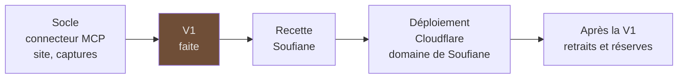

# Feuille de route

Mise à jour le 2026-11-02. Le code de la V1 est figé, la recette de Soufiane est la prochaine étape.

## Fait en V1

### Connecteur et site

- [x] Connecteur MCP sur Cloudflare avec OAuth 2.1 (PKCE, consentement, token GitHub chiffré), 14 outils et 4 prompts
- [x] Site : connexion GitHub, API JSON, génération en streaming avec la clé API de l'utilisateur
- [x] Identité par id GitHub numérique, données chiffrées dans KV, conservation de 90 jours
- [x] Historique des brouillons, partagé entre Claude et le site
- [x] Style d'écriture mémorisé côté serveur (`lire_style`, `sauver_style`, Réglages)
- [x] Captures de sites sur domaines vérifiés, données sensibles floutées

### Posts

- [x] 5 types de post : présentation, tuto, coulisses, leçon, semaine (`preparer_post`, tableau en 4 étapes)
- [x] Lecture du repo pour le tuto : arborescence, README et fichiers clés choisis (modifiables), secrets et fichiers générés écartés
- [x] Post du projet (`preparer_post` type `presentation`, panneau du studio), au format « Aujourd'hui je vous présente »
- [x] Masquage des jetons de formats connus dans les contenus de repo

### Pub vidéo du projet

- [x] 3 trames, 14 types de scènes, gestes et but par scène, anti-répétition
- [x] Outils MCP `preparer_pub`, `sauver_pub`, `lister_pubs`, `lire_pub` et prompt `pub_projet`
- [x] Studio : Mes pubs, assistant (3 questions, captures), éditeur, aperçu, export MP4 avec miniature PNG, SRT et rapport de contrôles
- [x] Voix : Vivienne par le Worker (edge-tts), Kokoro dans le navigateur en secours, voix importée, sans voix
- [x] Musique et effets générés par le code, mixage sous la voix
- [x] Pub de Weekli sur la page d'accueil

### Sécurité, RGPD et qualité

- [x] Export des données (`GET /api/moi/donnees`) et effacement complet (grants, Durable Objects, autorisation GitHub, sessions)
- [x] Pages Confidentialité et Mentions légales alignées sur le code
- [x] Isolation cross-origin (COOP et COEP), polices et modèle vocal hébergés par Weekli
- [x] Licence GPL-3.0-only
- [x] Audits sécurité du 2026-10-24 et du 2026-10-29 : 0 bloquant, 0 majeur après corrections

## Reste à faire

### Avant l'ouverture publique

| Tâche | Détail |
|---|---|
| Recette de Soufiane | Parcours complet des 5 types de post, du studio et de l'export |
| Test du connecteur dans Claude | Ajouter le connecteur dans Claude et vérifier les 14 outils. En local, cela passe par un tunnel (voir [installation.md](installation.md)) |
| Déploiement Cloudflare | Sur le domaine de Soufiane : namespace KV, secrets, `PUBLIC_URL`, app OAuth GitHub de production avec ses 2 URI de redirection |
| Voix Vivienne | Décision de fond avant une ouverture large : service Microsoft non officiel et sans contrat. Option : Azure Speech sous contrat |
| Quotas Cloudflare | Vérifier les écritures KV quotidiennes de l'offre gratuite avec le cache vocal |

### Réserves mineures de l'audit

Détail dans `docs/reviews/securite-final-2026-10-29.md`.

| Réf. | Réserve |
|---|---|
| N4 | Cache vocal partagé : une phrase déjà synthétisée se devine encore par la latence, oracle de faible portée accepté. Écritures KV bornées à 200 phrases par jour et par compte |
| m3 | Accepté : les images et fonds CSS d'autres origines restent affichés dans les captures. Le domaine capturé est prouvé par l'utilisateur, et les bloquer casserait les sites servis par un CDN |
| m12 | GitHub : `main` non protégée, alertes et mises à jour de sécurité Dependabot désactivées, signalement privé désactivé |
| m13 | Adresse `noreply` configurée dans ce dépôt pour les nouveaux commits. Les anciens commits gardent l'adresse personnelle : réécrire l'historique est à décider par Soufiane |

### Après la V1

- [ ] Mesurer la voix Kokoro sur Edge, Firefox et Safari (seul Chrome a été mesuré)
- [ ] Export de la pub en 4:5
