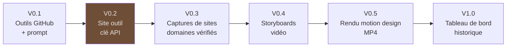

# Feuille de route

## V0.1 : outils GitHub

- [x] Serveur MCP sur Cloudflare avec OAuth GitHub
- [x] `activite_github`, `details_repo`, `details_commit`
- [x] Prompt `posts_semaine`
- [x] Site vitrine
- [x] Tests unitaires du filtrage

## V0.2 : le site devient un outil *(en cours)*

- [x] Monorepo `core` / `server` / `web`
- [x] Front React : accueil et tableau de bord
- [x] Connexion GitHub du site, API JSON
- [x] Génération en streaming avec la clé API de l'utilisateur
- [x] Docker Compose, CI, CSP
- [ ] Test du flux OAuth réel et déploiement public

## V0.3 : captures de sites

- [ ] Vérification de propriété de domaine (DNS TXT ou fichier `.well-known`)
- [ ] `capturer_site` via Cloudflare Browser Rendering
- [ ] Floutage automatique des données sensibles

## V0.4 : storyboards vidéo

- [ ] Outil `creer_storyboard` : scènes, durées, textes, captures
- [ ] Bibliothèque de scènes : terminal, problème/solution, avant/après, architecture, liste

## V0.5 : rendu motion design

- [ ] Scènes en HTML + GSAP
- [ ] Rendu MP4 1080×1350 (format LinkedIn 4:5)
- [ ] Sous-titres incrustés

## V1.0 : tableau de bord

- [x] Historique des brouillons et des posts publiés
- [ ] Style d'écriture mémorisé par utilisateur
