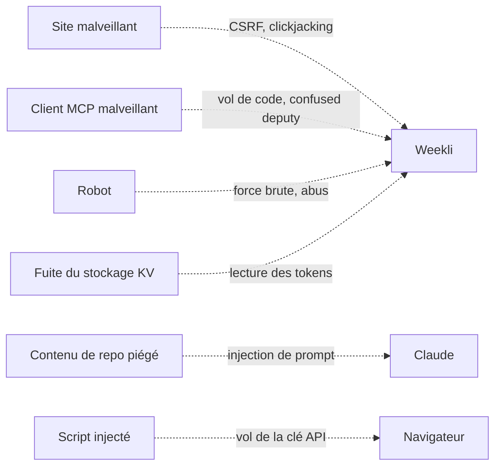

# Sécurité

## Principes

1. **Moindre privilège** : scope GitHub `read:user`, donc accès aux seules données publiques.
2. **Aucun secret côté client** : ni Claude ni le navigateur ne voient le token GitHub.
3. **Pas d'IA côté serveur** : aucune clé d'IA à voler, aucune injection de prompt exploitable dans le serveur. Seule exception de transit : le texte d'une phrase de voix off part vers le service de lecture d'Edge (voir plus bas).
4. **L'humain valide** : aucun outil ne publie ni n'écrit sur GitHub ou LinkedIn. Les seuls outils qui écrivent (`sauver_brouillons`, `sauver_pub`, `sauver_style`) n'agissent que sur les données Weekli du compte connecté.
5. **Défense en profondeur** : chaque couche suppose que la précédente peut céder.

## Modèle de menace

| Menace | Protection |
|---|---|
| Vol du code d'autorisation | PKCE S256 obligatoire **vers Claude et vers GitHub** |
| Confused deputy (un client MCP détourne l'app GitHub de Weekli) | Consentement par client **avant** toute redirection vers GitHub, géré par `@cloudflare/workers-oauth-provider` |
| Formulaire de consentement forgé ou rejoué | Demande gardée côté serveur, formulaire lié au navigateur par un cookie `__Host-`, usage unique, 10 minutes ; CSP sans script hors nonce, `form-action` limité au site et à GitHub |
| Client MCP au nom trompeur | Nom échappé, domaine de redirection affiché, alerte si la redirection va vers `localhost` |
| Token accepté par un autre service | Audience liée à la ressource `PUBLIC_URL/mcp` (RFC 8707, RFC 9728) |
| CSRF | Cookies `SameSite=Lax` **et** vérification de l'en-tête `Origin` sur toute requête d'écriture |
| Clickjacking | `X-Frame-Options: DENY` et `frame-ancestors 'none'` |
| Injection de script, vol de la clé API | CSP stricte (`script-src 'self' 'wasm-unsafe-eval'`, `connect-src` limité au site et à `api.anthropic.com`), React échappe tout, aucun `dangerouslySetInnerHTML` |
| Fixation de session | Nouvel identifiant aléatoire de 256 bits à chaque connexion |
| Fuite du stockage KV | Sessions et vérifieurs PKCE chiffrés en AES-256-GCM (clé dérivée par HKDF) ; tokens MCP stockés uniquement sous forme de hachage par la bibliothèque |
| Force brute, abus | 20 requêtes par minute et par IP sur l'authentification, 60 par minute et par utilisateur sur l'API et le MCP |
| Injection via les paramètres | Noms de repo et SHA validés par expression régulière, côté API et côté outils MCP |
| Lecture des données d'un autre utilisateur | Les outils utilisent toujours le `login` du token, jamais un propriétaire passé en paramètre |
| Accès à un repo privé | Scope `read:user` et refus explicite dans `details_repo` |
| Injection de prompt via un README, un commit ou un fichier de tuto | Données renvoyées en JSON sous `contenu_non_fiable`, rappel dans chaque outil et chaque prompt, jetons connus masqués, Claude reste l'agent de l'utilisateur, aucun outil n'a d'effet de bord hors des données Weekli |
| Cache vocal partagé sondé | Quota de 60 phrases par heure et par compte, compté aussi sur les réponses du cache ; entrées gardées 30 jours. Reste possible : deviner par la latence si une phrase exacte a déjà été synthétisée (résidu N4) |
| Fuite d'informations | Erreurs génériques côté client, détail uniquement dans les logs |
| Dépendance vulnérable | `npm audit` bloquant en CI, Dependabot hebdomadaire |
| Secret commité par erreur | `scripts/verifier-secrets.mjs` en hook local (commit et push) et en CI |

## Sessions du site

| Sujet | Choix |
|---|---|
| Cookie | `HttpOnly`, `SameSite=Lax`, préfixe `__Host-` en HTTPS, 8 heures (durée de vie des tokens GitHub) |
| Contenu | Uniquement un identifiant aléatoire. Les données (token GitHub compris) sont chiffrées dans KV. |
| Connexion | `state` aléatoire stocké chiffré dans KV avec le vérifieur PKCE, lié au navigateur par cookie, usage unique |
| Déconnexion | `POST /auth/logout` supprime la session de KV, révoque le token GitHub de cette session, mais garde l'autorisation du connecteur Claude |
| Identité | Toutes les données sont rangées sous l'**id GitHub numérique**, jamais sous le login (renommable). Une migration des anciennes clés par login existe encore et sera retirée avant le déploiement public (B14) |

## Clé API Anthropic

Elle ne quitte jamais le navigateur : stockée en `sessionStorage` (effacée à la fermeture de l'onglet) ou en `localStorage` si l'utilisateur le demande, puis envoyée directement à `api.anthropic.com`. La CSP empêche tout script étranger de la lire ou de l'envoyer ailleurs.

## En-têtes

- Front : `apps/web/public/_headers` (CSP, HSTS, COOP, COEP, `nosniff`, `Referrer-Policy`, `Permissions-Policy`).
- **COOP `same-origin` et COEP `require-corp`** : la page est isolée (`crossOriginIsolated`), condition du calcul multi-fil de la voix Kokoro. Conséquence : toute ressource tierce doit être chargée avec `crossorigin="anonymous"` (les avatars GitHub répondent `Access-Control-Allow-Origin: *`). Le serveur Vite de développement envoie les mêmes en-têtes.
- La CSP autorise `'wasm-unsafe-eval'` (compilation du WebAssembly d'onnxruntime-web, ni `eval` ni `new Function`) et `worker-src 'self'` (le Worker vocal vient du site). Aucune nouvelle origine : les polices et le modèle vocal sont servis par Weekli.
- Réponses du Worker : `apps/server/src/lib/securite.ts` (`nosniff`, `X-Frame-Options`, HSTS en HTTPS, `no-store` sur l'API).
- Pages servies par le Worker (consentement, erreurs) : CSP `default-src 'none'`, sans aucun script.

## Secrets

| Secret | Usage |
|---|---|
| `GITHUB_CLIENT_ID` | Identifiant de l'app OAuth GitHub |
| `GITHUB_CLIENT_SECRET` | Échange du code GitHub contre un token |
| `COOKIE_ENCRYPTION_KEY` | Racine du chiffrement des sessions et de la mémorisation du consentement (64 caractères hexadécimaux) |

En production : `npx wrangler secret put <NOM>`. En local : `apps/server/.dev.vars`, jamais commité (exclu par Git **et** bloqué par le garde-fou).

## Développement local

Le Worker et Vite n'écoutent que sur `127.0.0.1` : invisibles depuis le réseau local (Wi-Fi public, école). Dans Docker, les services écoutent sur `0.0.0.0` à l'intérieur du conteneur, mais `docker-compose.yml` ne publie leurs ports que sur `127.0.0.1`.

## Recommandé côté GitHub

Dans *Settings → Code security* du dépôt, active **Secret scanning** et **Push protection** : GitHub bloquera aussi tout secret connu au moment du push.

## Captures de sites

Sans garde-fou, un outil de capture permet de photographier le site de n'importe qui, ou de sonder un réseau interne (SSRF). Les protections :

| Risque | Protection |
|---|---|
| Capturer le site d'un autre | Preuve de propriété obligatoire : enregistrement TXT `_weekli.<domaine>` ou fichier `/.well-known/weekli-verification.txt`, avec un jeton HMAC propre au couple utilisateur et domaine |
| Atteindre une adresse interne (SSRF) | Noms d'hôte publics uniquement (ni IP, ni `localhost`, ni domaine interne), HTTPS obligatoire, drapeau `global_fetch_strictly_public` qui interdit au Worker toute adresse privée |
| Redirection vers un autre site | Redirection HTTP vérifiée avant d'ouvrir le navigateur, adresse finale vérifiée après le chargement |
| Fuite de données à l'écran | Emails, IP, tokens, JWT, longues chaînes hexadécimales et champs sensibles floutés dans la page avant la capture |
| Abus | 5 captures et 5 vérifications par minute et par utilisateur, 10 domaines au maximum |
| Conservation | Aucune image stockée : elle est renvoyée puis oubliée |

La vérification par fichier ne suit aucune redirection, lit au plus 1 Ko et abandonne après 5 secondes.

## Pub vidéo

Le rendu se fait **entièrement dans le navigateur** (canvas, WebCodecs). Le script de pub, qu'il vienne de Claude ou de l'éditeur, est nettoyé par `nettoyerScriptPub` (`@weekli/core`) : types de scènes connus uniquement, textes tronqués, couleurs `#rrggbb`, captures référencées existantes, durées bornées, 24 Ko au plus, 20 pubs par compte. Il ne contient que des données, jamais de code exécuté. Le logo et les images importés sont lus localement en `ImageBitmap` et ne sont jamais envoyés. Les pubs sont chiffrées dans KV et gardées 90 jours après leur dernière modification.

## Voix off

| Choix | Ce qui part où |
|---|---|
| **Vivienne** | Le texte de la phrase (400 caractères au plus) va au Worker, qui le transmet à Microsoft (service de lecture d'Edge). Aucune identité, aucun lien avec le compte. Service **tiers, sans contrat ni sous-traitance, usage non officiel** : il peut être coupé, le studio bascule alors sur Kokoro |
| **Kokoro** | Tout reste dans le navigateur. Le modèle (environ 94 Mo) est téléchargé depuis Weekli, vérifié par SHA-256, et gardé dans IndexedDB |
| **Ma voix**, **Sans voix** | Rien n'est envoyé |

Le cache vocal du Worker est partagé entre comptes (clé : SHA-256 de la voix et du texte), 30 jours. Avant une ouverture publique large, l'option sûre est de remplacer Vivienne par Azure Speech sous contrat (décision hors code).

## Données du compte

| Droit | Mise en œuvre |
|---|---|
| Conservation | Brouillons, pubs, style et domaines sont chiffrés (AES-256-GCM) dans KV et expirent 90 jours après la dernière écriture. Session : 8 heures. Autorisation du connecteur Claude : 30 jours. Un Durable Object MCP inactif 24 heures est détruit |
| Accès et portabilité | `GET /api/moi/donnees` renvoie profil, brouillons, pubs, style et domaines en JSON, sans le token GitHub |
| Effacement | `DELETE /api/moi/donnees` supprime les données KV (clés par id et anciennes clés par login), révoque toutes les autorisations du connecteur (grants), détruit les Durable Objects MCP, révoque l'autorisation de l'app chez GitHub, ferme toutes les sessions et efface le cookie. Chaque étape est tentée même si une autre échoue ; si KV échoue, la réponse est `500` et la session est gardée pour relancer. Après effacement, Claude doit refaire l'autorisation |
| Effacement local | Le panneau Données du site efface aussi ce que le navigateur garde : clé API, préférences, bases IndexedDB (images, logo, cache vocal), dernier repo |

Le contact RGPD et le détail sont dans la page Confidentialité du site.

## Réserves connues

Suivies dans [roadmap.md](roadmap.md) et dans `docs/reviews/securite-final-2026-10-29.md` : cache vocal sondable par la latence (N4), JWT non masqués (N6), images et fonds CSS d'autres origines dans une capture (m3), protection de la branche `main` et alertes Dependabot à activer (m12), adresse personnelle dans les derniers commits (m13).
