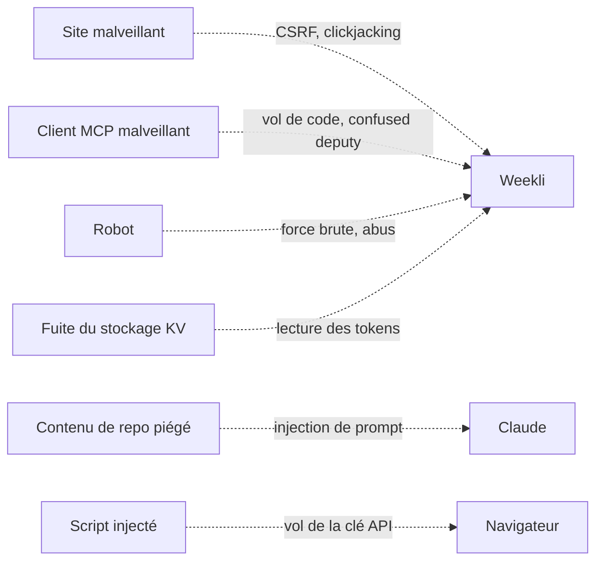

# Sécurité

## Principes

1. **Moindre privilège** : scope GitHub `read:user`, donc accès aux seules données publiques.
2. **Aucun secret côté client** : ni Claude ni le navigateur ne voient le token GitHub.
3. **Pas d'IA côté serveur** : aucune clé d'IA à voler, aucune injection de prompt exploitable dans le serveur.
4. **L'humain valide** : aucun outil n'écrit ni ne publie.
5. **Défense en profondeur** : chaque couche suppose que la précédente peut céder.

## Modèle de menace

| Menace | Protection |
|---|---|
| Vol du code d'autorisation | PKCE S256 obligatoire **vers Claude et vers GitHub** |
| Confused deputy (un client MCP détourne l'app GitHub de Weekli) | Consentement par client **avant** toute redirection vers GitHub, géré par `@cloudflare/workers-oauth-provider` |
| Formulaire de consentement forgé ou rejoué | Demande gardée côté serveur, formulaire lié au navigateur par un cookie `__Host-`, usage unique, 10 minutes |
| Client MCP au nom trompeur | Nom échappé, domaine de redirection affiché, alerte si la redirection va vers `localhost` |
| Token accepté par un autre service | Audience liée à la ressource `PUBLIC_URL/mcp` (RFC 8707, RFC 9728) |
| CSRF | Cookies `SameSite=Lax` **et** vérification de l'en-tête `Origin` sur toute requête d'écriture |
| Clickjacking | `X-Frame-Options: DENY` et `frame-ancestors 'none'` |
| Injection de script, vol de la clé API | CSP stricte (`script-src 'self'`, `connect-src` limité au site et à `api.anthropic.com`), React échappe tout, aucun `dangerouslySetInnerHTML` |
| Fixation de session | Nouvel identifiant aléatoire de 256 bits à chaque connexion |
| Fuite du stockage KV | Sessions et vérifieurs PKCE chiffrés en AES-256-GCM (clé dérivée par HKDF) ; tokens MCP stockés uniquement sous forme de hachage par la bibliothèque |
| Force brute, abus | 20 requêtes par minute et par IP sur l'authentification, 60 par minute et par utilisateur sur l'API et le MCP |
| Injection via les paramètres | Noms de repo et SHA validés par expression régulière, côté API et côté outils MCP |
| Lecture des données d'un autre utilisateur | Les outils utilisent toujours le `login` du token, jamais un propriétaire passé en paramètre |
| Accès à un repo privé | Scope `read:user` et refus explicite dans `details_repo` |
| Injection de prompt via un README | Données renvoyées en JSON, Claude reste l'agent de l'utilisateur, aucun outil n'a d'effet de bord |
| Fuite d'informations | Erreurs génériques côté client, détail uniquement dans les logs |
| Dépendance vulnérable | `npm audit` bloquant en CI, Dependabot hebdomadaire |
| Secret commité par erreur | `scripts/verifier-secrets.mjs` en hook local (commit et push) et en CI |

## Sessions du site

| Sujet | Choix |
|---|---|
| Cookie | `HttpOnly`, `SameSite=Lax`, préfixe `__Host-` en HTTPS, 7 jours |
| Contenu | Uniquement un identifiant aléatoire. Les données (token GitHub compris) sont chiffrées dans KV. |
| Connexion | `state` aléatoire stocké chiffré dans KV avec le vérifieur PKCE, lié au navigateur par cookie, usage unique |
| Déconnexion | `POST /auth/logout` supprime la session de KV, pas seulement le cookie |

## Clé API Anthropic

Elle ne quitte jamais le navigateur : stockée en `sessionStorage` (effacée à la fermeture de l'onglet) ou en `localStorage` si l'utilisateur le demande, puis envoyée directement à `api.anthropic.com`. La CSP empêche tout script étranger de la lire ou de l'envoyer ailleurs.

## En-têtes

- Front : `apps/web/public/_headers` (CSP, `nosniff`, `Referrer-Policy`, `Permissions-Policy`).
- Réponses du Worker : `apps/server/src/lib/securite.ts` (`nosniff`, `X-Frame-Options`, HSTS en HTTPS, `no-store` sur l'API).
- Pages servies par le Worker (consentement, erreurs) : CSP `default-src 'none'`, sans aucun script.

## Secrets

| Secret | Usage |
|---|---|
| `GITHUB_CLIENT_ID` | Identifiant de l'app OAuth GitHub |
| `GITHUB_CLIENT_SECRET` | Échange du code GitHub contre un token |
| `COOKIE_ENCRYPTION_KEY` | Racine du chiffrement des sessions et de la mémorisation du consentement (64 caractères hexadécimaux) |

En production : `npx wrangler secret put <NOM>`. En local : `apps/server/.dev.vars`, jamais commité (exclu par Git **et** bloqué par le garde-fou).

## Recommandé côté GitHub

Dans *Settings → Code security* du dépôt, active **Secret scanning** et **Push protection** : GitHub bloquera aussi tout secret connu au moment du push.

## Captures de sites

Sans garde-fou, un outil de capture permet de photographier le site de n'importe qui, ou de sonder un réseau interne (SSRF). Les protections :

| Risque | Protection |
|---|---|
| Capturer le site d'un autre | Preuve de propriété obligatoire : enregistrement TXT `_weekli.<domaine>` ou fichier `/.well-known/weekli-verification.txt`, avec un jeton HMAC propre au couple utilisateur et domaine |
| Atteindre une adresse interne (SSRF) | Noms d'hôte publics uniquement (ni IP, ni `localhost`, ni domaine interne), HTTPS obligatoire, drapeau `global_fetch_strictly_public` qui interdit au Worker toute adresse privée |
| Redirection vers un autre site | Redirection HTTP vérifiée avant d'ouvrir le navigateur, adresse finale vérifiée après le chargement |
| Fuite de données à l'écran | Emails, IP, tokens, JWT, longues chaînes hexadécimales et champs sensibles floutés dans la page avant la capture |
| Abus | 5 captures et 5 vérifications par minute et par utilisateur, 10 domaines au maximum |
| Conservation | Aucune image stockée : elle est renvoyée puis oubliée |

La vérification par fichier ne suit aucune redirection, lit au plus 1 Ko et abandonne après 5 secondes.

## Vidéos

Le rendu vidéo se fait **entièrement dans le navigateur** (canvas, `MediaRecorder`). Le storyboard, qu'il vienne de Claude ou de l'utilisateur, est nettoyé par `nettoyerStoryboard` : types de scènes connus uniquement, textes tronqués, durées bornées. Il ne contient que du texte, jamais de code exécuté.
