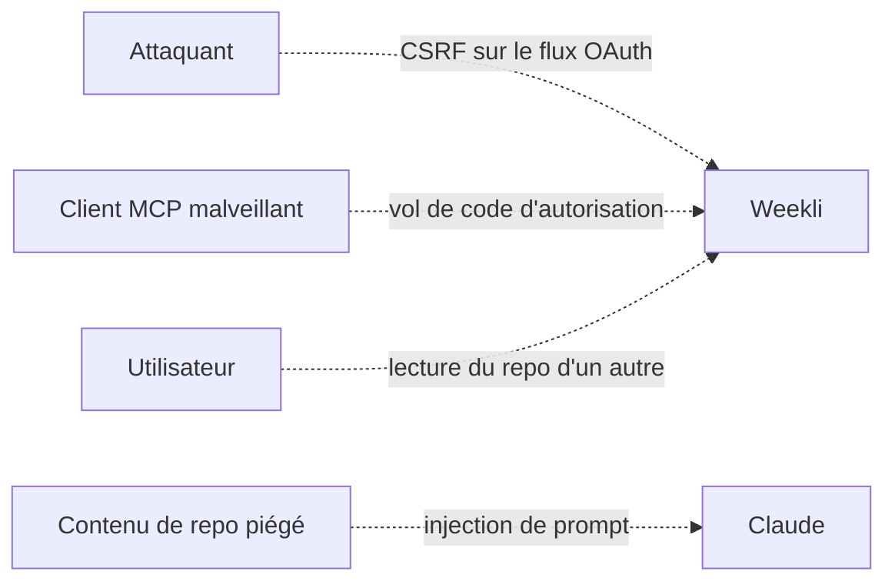

# Sécurité

## Principes

1. **Moindre privilège** : scope GitHub `read:user`, donc accès aux seules données publiques.
2. **Pas de secret côté client** : Claude ne reçoit jamais le token GitHub.
3. **Pas d'IA côté serveur** : rien à exfiltrer par injection de prompt dans le serveur lui-même.
4. **L'humain valide** : aucun outil n'écrit ni ne publie.

## Modèle de menace

| Menace | Protection |
|---|---|
| CSRF sur `/authorize` | Token CSRF dans un cookie `__Host-` + vérification au POST |
| Injection de `state` OAuth | `state` stocké en KV **et** lié au navigateur par cookie, usage unique |
| Vol du code d'autorisation | PKCE (S256) géré par `workers-oauth-provider`, `redirect_uri` comparée à celles enregistrées par le client |
| Client inconnu qui usurpe un nom | Écran de consentement qui affiche le client et ses URLs de redirection |
| Lecture des données d'un autre utilisateur | Les outils utilisent toujours le `login` du token, jamais un propriétaire passé en paramètre |
| Accès à un repo privé | Scope `read:user` et refus explicite dans `details_repo` |
| Injection de prompt via un README ou un commit | Les données sont renvoyées comme JSON, Claude reste l'agent de l'utilisateur, aucun outil n'a d'effet de bord |
| Fuite de secrets | Secrets dans `wrangler secret`, `.dev.vars` hors du dépôt |

## Secrets

| Secret | Usage |
|---|---|
| `GITHUB_CLIENT_ID` | Identifiant de l'app OAuth GitHub |
| `GITHUB_CLIENT_SECRET` | Échange du code GitHub contre un token |
| `COOKIE_ENCRYPTION_KEY` | Signature des cookies de consentement |

En production : `npx wrangler secret put <NOM>`. En local : fichier `.dev.vars`, jamais commité.

## À venir : captures de sites

L'outil `capturer_site` ne capturera que des domaines dont l'utilisateur a **prouvé la propriété** (enregistrement DNS TXT ou fichier `/.well-known/weekli.txt`), avec floutage automatique des emails, tokens et IP détectés.
