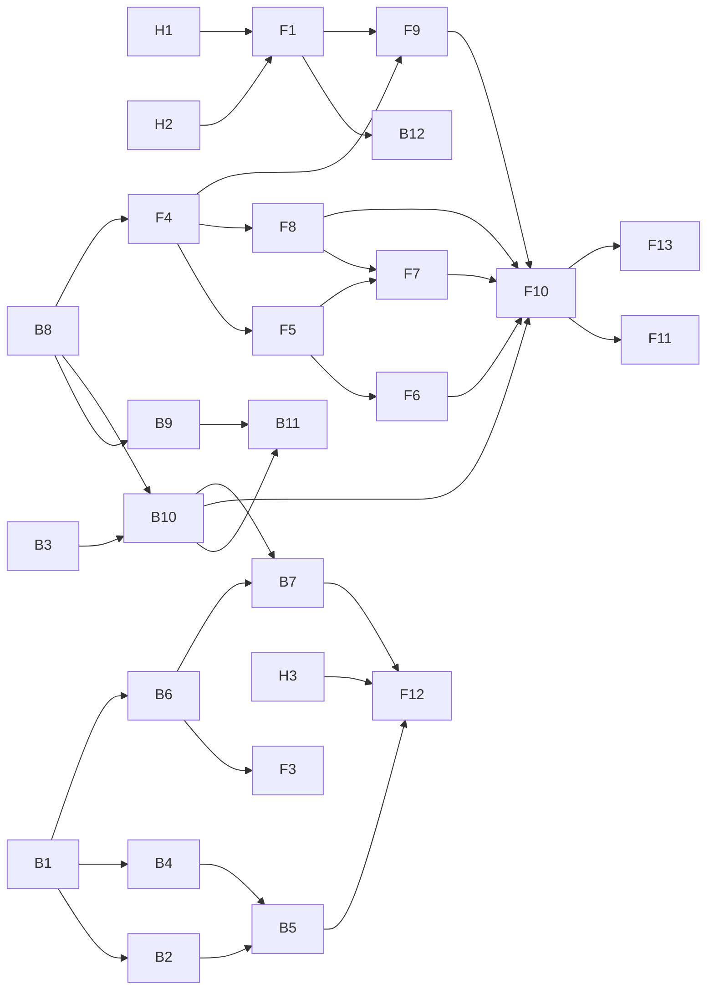

# Suivi des tâches

| # | Tâche | Agent | Modèle | Statut |
|---|---|---|---|---|
| 1 | Brief V1 | orchestrateur | opus | fait |
| 2 | Conception : specs, architecture, contrat d'API, design de la pub vidéo, banc d'essai des voix | architecte | opus | en cours |
| 3 | Audit sécurité et RGPD initial de l'existant | securite-senior | opus | en cours |
| 4 | RGPD backend : conservation 90 jours, suppression des données | backend-senior | sonnet | fait |
| 5 | Règle « vanilla » côté front, pages confidentialité et mentions légales | frontend-senior | sonnet | fait |
| 6 | Style d'écriture mémorisé | backend + frontend | à définir | à faire (attend le contrat d'API) |
| 7 | Pub vidéo : moteur, scènes, voix, outil MCP | backend + frontend | à définir | à faire (attend la conception) |
| 8 | Test OAuth de bout en bout en local | Soufiane + orchestrateur | | à faire (secrets à fournir) |
| 9 | Audit final et livraison | securite-senior | opus | à faire |

## Points remontés à traiter

| Point | Origine | Décision orchestrateur |
|---|---|---|
| La suppression des données ne révoque pas les autorisations MCP (grants) | backend | À faire : stocker l'id GitHub en session, révoquer les grants. Après le contrat d'API |
| Le style d'écriture est stocké dans le navigateur, la page Confidentialité le dit chiffré dans KV | frontend | Le style mémorisé côté serveur est dans la V1 : la page sera vraie à la livraison. Bloquant pour la livraison si non fait |
| Adresse de Cloudflare dans les mentions légales non sourcée | frontend | À vérifier avant livraison |
| Base légale RGPD absente de la page Confidentialité | frontend | À ajouter (intérêt légitime ou exécution du service), à valider par Soufiane |
| Valeurs CSS dynamiques passées en style (useReveal, Fonctionnalites, Etapes, Hero) | frontend | Accepté : variables calculées à l'exécution, pas du style statique |
| Effacement : si KV échoue, les sessions sont gardées pour permettre de relancer | backend | Accepté, à inscrire dans api-contract.md 3.1 |
| `PubResume.scenes` compte les scènes masquées ; types de pub dans `lib/pubs.ts` au lieu de core | backend | À trancher avec B11 : compter les visibles, déplacer les types dans core |
| Le chiffre « 6 outils MCP » de l'accueil est écrit en dur | frontend | À mettre à jour après B11 (13 outils prévus) |
| `robots.txt` absent (SEO 91) et performance 70 à cause du fond WebGL | frontend | À traiter avec F13, avant livraison |
| `apps/web/README.md` parle encore d'une vidéo 1080 × 1350 | frontend | À aligner avec F11 |
| `capturer_site` (MCP) lit encore les domaines sans revérification de 7 jours (m5) | backend | À faire avec B1/B2 : utiliser `domainesRevalides` dans `mcp/agent.ts` |
| m7 : forme des données GitHub dans `packages/core/src/github.ts` | backend | À faire avec B1 : ajout d'un champ, pas de changement de forme |
| m14 reste : préfixe de version et AAD du chiffrement | backend | À faire dans la migration M3 (B1) pour ne chiffrer qu'une fois |
| Build Docker non vérifié, `apps/video` absent de l'image | backend | À vérifier avant la livraison |

## Découpage

Rédigé par l'architecte le 2026-10-24. Références : `docs/specs.md` (US), `docs/architecture.md` (ADR), `docs/api-contract.md`, `docs/design.md`, `docs/reviews/securite-2026-10-24.md` (M et m). Chaque tâche se termine par typecheck et tests verts, aucun tiret long, un handoff à jour. Modèle conseillé : **sonnet** pour l'implémentation bien spécifiée, **opus** pour l'invention visuelle et les points à forte incertitude.

### Validations humaines (bloquantes)

| # | Quoi | Qui | Bloque |
|---|---|---|---|
| H1 | Écouter `.bench-voix/ecoute/` et choisir la voix (recommandation : Kokoro `ff_siwis`, ADR-07) | Soufiane | F1, F9 |
| H2 | Licence du front si espeak-ng (GPL-3.0) est embarqué : passer le front en GPL-3.0, ou isoler le module, ou renoncer à la synthèse dans le navigateur (ADR-07) | Soufiane | F1 |
| H3 | Valider le contenu RGPD de `docs/specs.md` section 5 (bases légales, sous-traitants, contact privé) | Soufiane | F12 |
| H4 | Valider la pub de démonstration comme « comparable à la référence » | Soufiane | Livraison |

### Backend

| # | Tâche | Dépend de | Critère de fini | Modèle |
|---|---|---|---|---|
| B1 | **Identité par id GitHub** (M3, ADR-01) : `Session` et `Props` portent `id` ; clés KV `<prefixe>:<id>` ; HMAC des domaines et clés de débit sur l'id ; `lib/identite.ts` migre les clés par login au premier login (site et MCP) | | Tests : un login renommé garde ses données, un nouveau compte au même login n'y accède pas ; migration testée sur brouillons et domaines | sonnet |
| B2 | **Props MCP minimales et chiffrées, DO bornés** (M2, m1, m6, ADR-03) : plus d'email ; token chiffré (`jeton`) ; `refreshTokenTTL` 30 jours ; identité relue à chaque appel et contrôle du propriétaire ; alarme de destruction à 24 h ; index `mcp:<id>` ; méthode RPC `detruire()` | B1 | Tests : props sans email ni token en clair ; appel avec des props d'un autre id refusé ; `detruire()` vide le stockage | sonnet |
| B3 | **Chiffrement sans limite de taille** (m9) : base64 par blocs dans `chiffrement.ts` et `github-oauth.ts` | | Test : chiffrer puis déchiffrer 1 Mo | sonnet |
| B4 | **Sessions indexées et déconnexion propre** (m2, ADR-02) : index `sessions:<id>` ; `POST /auth/logout` révoque le token chez GitHub (`DELETE /applications/{client_id}/token`) | B1 | Tests (fetch GitHub simulé) : index alimenté et nettoyé, révocation appelée, échec GitHub sans impact sur la déconnexion | sonnet |
| B5 | **Effacement complet** (M1, ADR-02) : `DELETE /api/moi/donnees` selon `api-contract.md` 3.1 (KV, grants, DO, autorisation GitHub, toutes les sessions) | B1, B2, B4, B6, B10 | Tests : chaque étape appelée ; un token MCP émis avant renvoie 401 ; `204` même si GitHub échoue ; `500` si KV échoue | sonnet |
| B6 | **Style d'écriture** (ADR-04) : `core/style.ts` (`nettoyerStyle`), `lib/style.ts`, `GET/PUT/DELETE /api/style`, outils `lire_style` et `sauver_style`, injection du style stocké dans `posts_semaine` | B1 | Tests core et API selon le contrat ; prompt sans argument contient le profil stocké | sonnet |
| B7 | **Export des données** (M5, ADR-12) : `GET /api/moi/donnees` | B1, B6, B10 | Test : JSON complet sans token, en-tête `Content-Disposition` | sonnet |
| B8 | **Core pub, partie données** : `pub/types.ts`, `limites.ts`, `nettoyer.ts`, `schema.ts`, `timeline.ts`, `palette.ts` | | Tests : chaque règle de `api-contract.md` 2.1 (rejets et avertissements), timeline avec chevauchements, contrastes de `paletteDepuisMarque` sur 10 couleurs dont gris, jaune pâle et bleu nuit | sonnet |
| B9 | **Core pub, partie rédaction** : `guide.ts` (catalogue, règles d'écriture de `design.md` 8.2, 8.12 et 8.13, en texte pour Claude) et `modele.ts` (`scriptPubDepuisReponses`, sans IA) | B8 | Test : le script de départ passe `nettoyerScriptPub` sans erreur pour 5 jeux de réponses ; relecture du guide par l'architecte | opus |
| B10 | **Stockage et API des pubs** (ADR-05) : `lib/pubs.ts`, `/api/pubs` (CRUD), `GET /api/repos` et `core.listerRepos` ; purge des entrées de plus de 90 jours à la lecture (brouillons compris) | B1, B3, B8 | Tests selon le contrat (201, 400 avec détails, 404, 409 au-delà de 20, purge) | sonnet |
| B11 | **Outils MCP de la pub** : `lister_repos`, `preparer_pub`, `sauver_pub`, `lister_pubs`, `lire_pub`, prompt `pub_projet` ; découpage d'`agent.ts` en fichiers par domaine ; `contenu_non_fiable` sur les contenus de repo (m7) ; mise à jour de `docs/outils.md` | B9, B10 | Tests des outils (entrées invalides, avertissements, lien du studio) ; recette dans Claude : une pub sauvée et ouverte sur le site | sonnet |
| B12 | **Modèle vocal servi par Weekli** (ADR-08) : `scripts/modeles-voix.mjs` (révision épinglée, SHA-256, découpe en 20 Mo, manifeste), appel depuis `npm run build`, dossier ignoré par Git | F1 (choix des fichiers) | Build qui produit `public/modeles/kokoro/` vérifié ; second build sans retéléchargement | sonnet |
| B13 | **Outil interne vidéo** (ADR-10) : retirer le format `histoire` de `apps/video` et du skill `video-projet`, passer `presentation` en 16:9, avertir que le skill ne s'utilise que sur des dépôts de confiance (m7), valider les arguments (m8) | | Skill et README cohérents avec le brief ; `produire` refuse un nom invalide | sonnet |
| B14 | **Retrait de la migration par login** avant tout déploiement public (ADR-01) | B1, livraison | Plus aucune lecture de clé par login dans le code | sonnet |

### Frontend

| # | Tâche | Dépend de | Critère de fini | Modèle |
|---|---|---|---|---|
| F1 | **Preuve de faisabilité de la voix** (ADR-07) : Kokoro `ff_siwis` en français dans un Web Worker (onnxruntime-web, WASM puis WebGPU), phonémiseur espeak-ng en WASM, dictionnaire de prononciation, cache IndexedDB ; mesures sur Chrome, Edge, Firefox, Safari ; choix exact des fichiers du modèle | H1, H2 | Le texte du banc est synthétisé dans Chrome desktop en moins de 60 s et sonne comme `.bench-voix/ecoute/09` ; rapport de mesures dans le handoff ; sinon repli documenté (Piper, puis voix importée seule) | opus |
| F2 | **Passe de cohérence du site** (design.md 2 à 6) : polices locales et CSP (M4, ADR-11), tokens d'échelle et d'espacement, verre réservé à l'app, textes « histoire » et « motion design » retirés, section Chiffres vérifiée | | Aucune requête tierce au chargement (onglet Réseau) ; Lighthouse accessibilité 100 sur l'accueil | sonnet |
| F3 | **Style mémorisé côté site** : panneau Style dans Réglages (`/api/style`), migration depuis `localStorage`, génération en mode clé API qui lit le style du serveur | B6 | Recette US-S1 et US-S3 ; plus aucune écriture du style dans le navigateur | sonnet |
| F4 | **Moteur de pub** (ADR-06, architecture 7) : `lib/pub/moteur.ts`, `contexte.ts`, timeline de core, aperçu à demi-résolution avec horloge audio, export WebCodecs image et son, repli WebM, sous-titres SRT ; scène de test simple pour valider la chaîne | B8 | Export d'une pub de test de 60 s avec son : durée exacte à une image près, lecture correcte dans QuickTime et VLC ; temps de rendu mesuré | sonnet |
| F5 | **Fondations visuelles** (design.md 8.4 à 8.8) : fonds sombre et clair, motif de carrés, grain, rayons, typographie cinétique (mot par mot, accent, surlignage, soulignement, frappe, impact, lettres), quatre transitions | F4 | Planche de démonstration exportée (chaque procédé 2 s) validée par l'orchestrateur sur des couleurs de marque variées | opus |
| F6 | **Scènes de tension et de révélation** : `ouverture`, `repetition`, `boucle`, `chorus`, `rupture`, `revelation` (particules, monogramme pixel, logo importé) | F5 | Rendu côte à côte avec les images de la référence aux mêmes instants ; aucun texte coupé à 80 % de l'échelle | opus |
| F7 | **Scènes produit et action** : `etape` (gabarit, onglets, filigrane), `resultat` (frise et tampon), `preuve`, `appel`, `fin` | F5, F8 | Idem F6 ; continuité de l'en-tête entre étapes | opus |
| F8 | **Captures en cartes** (design.md 8.10 et 8.11) : chargement via `/api/captures`, recadrage, carte bureau et mobile, Ken Burns, focus, vignettes, carte liste ; import d'images et du logo en IndexedDB ; extraction des couleurs dominantes | F4 | Captures d'un domaine vérifié et images importées rendues ; aucune image envoyée au serveur hors capture (onglet Réseau) | sonnet |
| F9 | **Audio** (ADR-09) : client du Worker vocal (à partir de F1), musique générée (port d'`audio.mjs`), effets, mixage avec baisse sous la voix, voix importée | F1, F4 | Mixage exporté autour de -16 LUFS mesuré par `ffmpeg -af ebur128` ; voix et image synchronisées | sonnet |
| F10 | **Studio** (design.md 9) : Mes pubs, projet, 3 questions, captures, éditeur (scènes, marque, voix), export ; ouverture par `?pub=<id>` ; sauvegarde différée ; script de départ ; « Écrire avec Claude » en mode clé API (`genererScriptPub`) | B10, F4, F8 | Recette US-P1 à US-P9 ; parcours clavier complet ; `prefers-reduced-motion` respecté hors export | sonnet |
| F11 | **Retrait de l'ancien studio** (ADR-10) : `lib/video/`, `core/storyboard.ts`, `genererStoryboard`, liens associés | F10 | Plus aucune référence ; tests et typecheck verts | sonnet |
| F12 | **RGPD côté site** : page Confidentialité réécrite selon `docs/specs.md` section 5 (M5) ; panneau Données avec export (`GET /api/moi/donnees`) et texte exact de l'effacement (ADR-02) ; attribution SIWIS dans les mentions légales | H3, B5, B7 | Chaque affirmation de la page correspond au code ; export téléchargé et lisible | sonnet |
| F13 | **Section « La pub de ton projet » de l'accueil** (design.md 5) avec la pub de démonstration exportée | F10, H4 | Vidéo servie en local (pas de lecteur tiers), affiche, sans son par défaut, pause si mouvement réduit | sonnet |

### Ordre conseillé

Parallélisable dès maintenant : B1, B3, B8, F2, et F1 dès que H1 et H2 sont tranchés.

## Avancement (orchestrateur, 2026-10-25)

| Tâche | Statut | Modèle |
|---|---|---|
| H1 voix | Fait : Vivienne (edge-tts) en principal, Kokoro en secours (voir changelog) | |
| H2 licence | Fait : GPL-3.0-only | |
| H3 RGPD | Fait : contact RGPD soufianefilalipro@gmail.com (pages Confidentialité et Mentions légales, F12) | |
| B1, B2, B3, B4, B5, B6, B7, B8, B9, B10, B11, B13 | Fait, commité | sonnet (B9 opus) |
| B12 modèle vocal au build, masquage des jetons | En cours | sonnet |
| B14 retrait de la migration | À faire avant déploiement | |
| F1 voix, F2 cohérence, F4 moteur, F5 visuel, F8 cartes | Fait, commité | F1 et F5 opus, autres sonnet |
| F6 scènes tension, F7 scènes produit | En cours | opus |
| F9 audio, COEP | En cours | sonnet |
| F3, F10, F11, F12, F13 | À faire | |

## Reprise (après la pause du 2026-10-25)

Ordre, avec un minimum d'agents :
1. Relancer F6 et F7 (opus, travail sauvegardé non commité dans lib/pub/scenes/), et F9 + COEP (sonnet, lib/pub/audio, _headers, vite.config.ts). Référence visuelle : docs/reviews/reference/stepwize-planche.png (une image toutes les 2 s, de gauche à droite puis ligne par ligne : la case n correspond à 2 x (n - 1) s).
2. Un seul agent sonnet pour F10 (studio), puis F11 (retrait de l'ancien studio) dans la foulée.
3. Un seul agent sonnet pour F3 (style côté site), F12 (RGPD, attend l'adresse de contact) et le chiffre « 13 outils » de l'accueil.
4. F13 et robots.txt, performance du fond WebGL.
5. Une seule passe d'alignement des docs (sonnet), puis audit final (opus), recette avec Soufiane, B14 avant déploiement.
6. Nouvelle tâche B15 (sonnet), à faire avec F9 : point d'entrée du Worker qui obtient la voix Vivienne par edge-tts (WebSocket sortant, jeton Sec-MS-GEC), avec limite par utilisateur, cache par empreinte du texte, et repli Kokoro côté navigateur en cas d'échec. Page Confidentialité (F12) : mentionner Microsoft comme destinataire des textes de voix off.
7. Nouvelle fonctionnalité demandée par Soufiane (2026-10-25) : « Post du projet ». À partir d'un repo (README, description, captures, et script de pub s'il existe), l'IA propose 2 ou 3 versions d'un post LinkedIn qui présente le projet et accompagne la pub vidéo. Ton du style mémorisé, aucune invention. Format voulu par Soufiane : une présentation du projet à la première personne, jamais de commits, de code ni de chiffres de développement. Trame type :
     - accroche : « Aujourd'hui je vous présente X » ;
     - ce que fait le projet et le problème qu'il règle ;
     - pourquoi je l'ai fait (déclencheur personnel, besoin observé) ;
     - comment je l'ai conçu, au niveau de l'idée et de la démarche, par exemple construit en agentic avec une équipe d'agents IA, sans détail technique ;
     - pour qui, et ce que ça change ;
     - appel : lien, essai, retour attendu.
     Les questions manquantes (pourquoi, démarche) sont posées à l'utilisateur, jamais devinées.
   - B16 (sonnet) : outil MCP `proposer_post_projet` et prompt associé (même principe que preparer_pub : Weekli fournit les données et les règles, Claude rédige). Règles d'écriture dans core.
   - F14 (sonnet) : panneau « Post LinkedIn » dans le studio et sur la page du projet : propositions, copie en un clic, régénération ; en mode clé API, génération dans le navigateur.

## Impacts de la discipline de production (2026-10-25, design.md 8.16)

- **F10 (moteur et studio), ajouts** :
  - Application des gestes choisis : lire `script.gestes` et ne jouer que ces gestes, chaque autre geste prenant sa version neutre (table de repli dans design.md 8.16). Sans `gestes`, comportement actuel. Fini quand : deux scripts du même exemple, l'un avec `["accent", "soulignement", "flou"]`, l'autre avec `["impact", "glitch", "lettres"]`, donnent deux films visiblement différents, et un test de rendu vérifie qu'un geste non choisi n'est pas déclenché.
  - Application de `but` : pause de lecture de 1,2 s, 0,8 s ou 0,5 s selon le but (défaut par type), dans les bornes de `DUREES_SCENE`, sans ralentir les gestes. `calculerTimeline` doit en tenir compte (modification de `timeline.ts`, hors du lot de cette mise à jour) et ses tests couvrir les trois buts. Fini quand : la durée d'une scène `lire` est supérieure ou égale à gestes plus 1,2 s dans ses bornes.
  - Image zéro complète : l'ouverture est rendue avec logo et nom déjà posés à t = 0. Fini quand : l'image 0 du MP4 est identique à la miniature PNG.
  - Miniature PNG 1920 x 1080 exportée avec le MP4 (même nom, extension `.png`), proposée en téléchargement dans le studio.
  - Contrôles finaux après export (design.md 8.16) : images aux raccords (planche de relecture), crête vraie sous -1,5 dBTP, absence de noirs involontaires, durée audio égale à la durée vidéo. Le rapport s'affiche dans le studio ; un échec bloque le téléchargement avec la cause.
  - Mention discrète « Illustration » sur les cartes illustratives dans la planche de relecture.
- **B9 / B11 (génération et outils MCP), ajouts** : `preparer_pub` renvoie déjà `regles` et `catalogue` depuis `guide.ts` (gestes, but, honnêteté inclus) ; le schéma de sortie structurée (`SCHEMA_SCRIPT_PUB`) contient `gestes` et `but`. Rien d'autre à coder, vérifier seulement à la recette que Claude renseigne `gestes`.
- **B16 (post du projet)** : utiliser `REGLES_POST_PROJET` (exportée par `@weekli/core`) comme règles de l'outil `proposer_post_projet`.

## Refonte du tableau par type de post (2026-10-29, specs 4.6, design 10, contrat 3.8 et 4.2)

Fait par l'architecte, dans `packages/core` (tests verts : `tsc --noEmit` et `vitest run`, 267 tests) : types et catalogue (`posts/types.ts`), validation (`validerDemandePost`), `lireRepoPourTuto` et `proposerFichiersTuto`, règles et consignes par type (`REGLES_POST`, `CONSIGNES_POST`), `donneesPost`, `commitsRepo`, `systemePost`, `messagePost`, `promptPreparerPost`.

- **B17 (sonnet) : route et outil MCP `preparer_post`.**
  - `GET /api/repos/:repo/commits?jours=`, `GET /api/repos/:repo/fichiers-tuto` et `POST /api/posts/donnees` selon `api-contract.md` 3.2 et 3.8 ; validation par `validerDemandePost`, identité de la session, `Origin`, débit, erreurs en français sans accent.
  - Outil MCP `preparer_post` (4.2) avec le cas `coulisses` sans `commits` (renvoie `commitsDisponibles`), prompt `preparer_post`, `proposer_post_projet` conservé. Compteur d'outils à 14.
  - Aucune logique dupliquée : tout passe par les fonctions de `@weekli/core`. Repo privé refusé, secrets masqués, contenus de repo en `contenu_non_fiable`.
  - Fini quand : tests serveur pour chaque type (succès, `400` pour chaque message de validation, `404` repo privé, `401`, `403`, `429`) avec Octokit simulé ; un fichier `.env` demandé dans `fichiers` n'est jamais lu ; `preparer_post` et la route renvoient le même `DonneesPost` pour la même demande ; `tsc --noEmit` et la suite de tests du serveur verts ; handoff écrit.
- **F16 (sonnet) : refonte du tableau selon `design.md` 10.** Dépend de B17 (en attendant, le front peut s'appuyer sur le démo `?demo`).
  - Parcours en 4 étapes (repo, type, réglages, posts), fil d'étapes, lien profond `?repo=&type=`, composants du tableau 10.8, `ReglagesSemaine` réutilise l'ancien flux sans le modifier.
  - `api.ts` : `commitsRepo`, `fichiersTuto`, `donneesPost` ; `generation.ts` : génération par type avec `systemePost` et `messagePost`, question de Claude gérée, mode sans clé avec la demande à copier.
  - Mise à jour du chiffre d'outils de l'accueil (14).
  - Fini quand : la liste des commits n'est jamais demandée pour `presentation` et `tuto` (test ou trace réseau en démo) ; chaque type a son état vide, ses validations et son erreur ; clavier complet et focus géré à chaque étape ; mobile 375 px sans défilement horizontal ; `prefers-reduced-motion` respecté ; `tsc --noEmit` et build verts ; recette avec Soufiane sur les 5 types.

